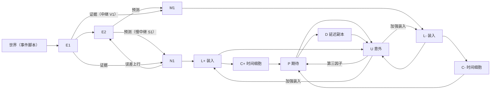
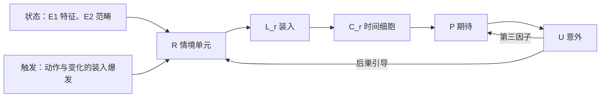

# 闭环架构设计

状态：草案，2026-10-10。本文件是新架构的设计依据，按节标注状态：

- **定稿**：已讨论确定，可以实现。
- **初稿**：有把握，但细节未逐条讨论；实现前需用户确认。
- **待讨论**：设计未定，讨论结束前不要实现。

全部各节已于 2026-10-10 定稿。

本文件取代 [ROADMAP.md](ROADMAP.md) 中第 2 段"沿有向通道自主演化"的目标。路线图与各段状态页等本文件定稿后再改。

## 1. 目标与四个核心问题

最终目标不变：用多层脉冲网络实现"经验 → 规则抽象 → 泛化预测 → 目标规划 → 行为 → 经验"的闭环。闭环拆成四个核心问题，各由几个模块负责：

| 问题 | 负责的模块 |
| --- | --- |
| 1. 任意常规时间尺度的事件序列怎么记住 | 第一级误差 N 标出事件边界，时间上下文 C 把边界两侧连起来 |
| 2. 相关经验怎么抽象成静态规律 | 当前状态 E 的范畴吸引子；第一级误差 |
| 3. 时间展开的序列怎么抽象成因果规律 | 预测 P、规则单元 R；第二级误差 U |
| 4. 怎样用预测与事实的误差对齐两种规律 | 两级误差分别送到静态与因果两侧；可靠度调质；新建单元 |

## 2. 放弃的路线【定稿】

不再用"层内有向通道 + 噪声推动的自主演化"表示转移。依据：

- 第 2 段 v2（标签 `attempt/2/attractor-chain-v2`）：用 `GB_RATE` 时，正向连接在 160 回合就停在约 0.087，反向为 0.043，方向差的增长来自反向衰减。此外必须把每项压到 40 ms，而且学习态（要浅）与演化态（要深）争用同一组递归权重。
- 第 2 段 v3（标签 `attempt/2/attractor-chain-v3`）：用 v2 的权重做演化态标定，增益 G 0.6–1.2 × 适应 b 20–80 pA 共 24 个组合里，撤掉线索后吸引子保持 ≥ 80 ms 的比例只有 0–10%，没有工作点，自主演化无从谈起。学习侧的最佳候选（`post2Tau` 50、η 2.4）把正向连接超出背景的部分从 0.046 提到 0.087，但学到了也表达不出来。
- 第 4 段：handover 加深上层后学成反向（X→Y 0.20、Y→X 0.28）；深层 v2 主要学到共现（X→Y 0.224、Y→X 0.154、同物体交叉 0.336、无关 0.217）。
- 项目里唯一学对方向的是误差驱动的"中继 → 误差"：正向 0.42 → 1.13，反向 0.33 → 0.21，每项 150 ms，不压缩。

已验证的旧结果（包括其中训练出的一步有向通道）保留，新架构不依赖它们。

## 3. 设计原则【定稿】

1. 全部用脉冲网络实现，不做速率原型。进共享代码的机制都要有逐拍或统计验证；ATP 照记。
2. 默认预测是"保持现状"。事件的开始与结束都是状态变化，都由误差标出，没有专门的"结束事件"。
3. 误差分两级：第一级对照"保持现状"，标出变化；第二级对照"预测的变化"，标出意外。
4. "现在"由 E 承载，"接下来"由 P 承载；E 不直接连到 P。
5. 跨越时间由 C 的放电承担；突触上的资格痕迹约 200 ms 即可。
6. 预测的对象是变化：哪一组会出现或消失、大约何时出现或消失；其余默认保持。
7. 学习由误差门控：只有没料到的部分被学进去。
8. E1 的特征组与变化通道按组组织（标签线），是预先设计的；E2 的范畴与 R 的情境可以预先提交，也可以由招募产生（第 12 节）。

## 4. 总体结构与约定

### 4.1 结构

- 第一层 E1 接收世界的输入（证据）；第二层 E2 是一池范畴单元，持有当前的解释。E2 经慢中继 S1 预测 E1，这就是"保持现状"的预测。
- N1、M1 是第一级误差：N1 表示证据多于预测（出现、多出），M1 表示预测多于证据（消失、缺少）。
- 变化经装入群 L 写进时间细胞 C；C 驱动期待 P；U 比较"预测的变化"与"观察到的变化"，给出第二级误差，并作为 P 学习的第三因子。变化发生时，L 还会经抑制性神经元把对应的 P 复位（图中未画）。
- P 不接 N1、M1。被正确预测的变化仍然产生第一级误差，因而照常标出边界、装入 C。
- 规则单元 R（第 10 节，图中未画）在触发时刻把当前状态与触发合成一个情境；情境的发生也写进 C，经同一套学习接到 P。

### 4.2 记号

- g：E1 的组。第一版是预先设计的特征组或事件组。
- c ∈ {+, −}：变化的方向，+ 为出现，− 为消失。每个 (g, c) 称为一个变化通道。
- O_g^+ 由 N1_g 给出，O_g^− 由 M1_g 给出，统称"观察到的变化"。
- U↑：变了却没料到。U↓：料到要变却没变。
- k：E2 的范畴单元。r：R 的情境单元。

### 4.3 时间与读出

- 积分步长 0.1 ms，与现有 `SpikingNetwork` 相同。
- 读出按 10 ms 分箱计算组平均频率。
- 每个群的基线 μ、σ 取同一状态下 2 s 静息的分箱频率；爆发阈值 θ = max(μ + 4σ, μ + 5 Hz)。

### 4.4 模块接口

- 每个模块是一个构建函数：在同一个 `SpikingNetwork` 上添加群和连接，返回各组的神经元编号、连接组句柄、读出函数、`saveState` / `loadState` 与自检。
- 模块之间只经突触相连。唯一的例外是三因素学习的第三因子：它读取 U 群的组平均频率，作为组内广播的标量，代表神经调质或树突上的教学信号。
- 需要 `onStep` 的模块不止一个时，由构建器统一分发。
- 第一版只有感知 / 学习一种模式。模拟与回放（P 写回 E）属于规划，以后讨论。

### 4.5 规模与速度

一个变化通道约 160 个神经元（第 7–9 节）。雷雨场景 3 组 × 2 个方向，加上 E1、E2 与第一级误差，共约 2000 个神经元。按 v2 的速度（900 个神经元约 6 s 墙钟算 1 s 模拟）估计，一套 40 场雷雨约需 4–5 小时，所以性能优化列为第一批工作（第 15 节 W0）。

第一版按场景只给需要的通道建全套：作为触发的通道建 C，作为结果的通道建 P/U，第一级误差照常给全部 E1 组建。否则像场景三这样有十来个特征组的世界，会到四五千个神经元。

## 5. 当前状态 E【定稿】

### 5.1 E1（证据层）

沿用 v2 S1 的配置（标签 `attempt/2/attractor-chain-v2` 上 `demo/attractor-chain.mjs` 的 `CONFIG`），组数 K1 按场景设定：

- 每组 80 个兴奋性神经元，另有 80 个不成组；抑制性神经元为兴奋性的 1/4。
- 组内 / 组间连接概率 0.25 / 0.083，接触点 10。
- 可塑参数 sMin 0.1、sMax 9、ρ0 0.1、accel 5、异突触预算 0.2，规则 `GB_RATE`。
- 抑制性可塑性 η 0.02、目标 3 Hz、上限 40；背景 30 / 12 Hz；适应 b 20 pA、τw 300 ms。
- 先用与 S1 相同的变体训练吸引子：每次刺激原型的 80% 加 20% 无关神经元，200 ms，休息 300 ms，兴奋→兴奋只在刺激期学，每组次数与 S1 相当。之后冻结兴奋→兴奋。
- 运行时增益 G = 0.6（v2 S1b：静息点燃率 2.7%，补全 +1.8 Hz）。

**E1 的验收**：每组组内 / 组间比 ≥ 2；补全 ≥ +0.5 Hz，且至多一组不为正；G = 0.6 时静息点燃率 ≤ 5%。

### 5.2 E2（范畴单元池）

E2 是一池范畴单元，做法与 R 相同：单元可以预先提交成设计好的原型，也可以从空池开始由招募产生（第 12.2 节）。分多细由招募的警戒门槛决定，后果再负责把不该合在一起的分开（第 12.3 节）。这就是问题二"静态规律怎么抽象"的做法。

**群：**

| 群 | 作用 | 初始规模 |
| --- | --- | --- |
| E2_k | 范畴单元，兴奋性；单元内部有递归，构成浅的吸引子 | 每个单元 20 |
| I2 | 共用的抑制性池，负责平衡与前馈抑制，沿用第 4 段上层的设置 | 单元总数的 1/4 |
| J_k | 单元 k 的侧向抑制细胞 | 每个单元 5 |

池的大小按场景设定，第一版 12–16 个单元。

**原型 W。** 每个单元 k 有一个原型向量 W_k：对每个 E1 组 g 有一个分量 W_kg，取值 0–1。E2 与 E1 之间的四条通路共用这份原型，每条通路有自己的总强度：

| 通路 | 类型 | 强度 |
| --- | --- | --- |
| E1_g → E2_k（识别） | 兴奋 | s_FF·W_kg |
| N1_g → E2_k（误差上行） | 兴奋 | sUp·W_kg |
| E2_k → S1_g（"保持现状"与补全的预测） | 只有 NMDA | sTD·W_kg |
| E2_k → M1_g（负误差一侧的预测） | 兴奋 | sNegP·W_kg |

- 识别与预测共用一份原型，是预测编码里"对称权重"的常见简化。
- 谁连谁在构建时按连接概率固定；学习只改 W，再由 W 改写这四个连接组的 `scale`。

**竞争：**

- 靠"解释掉"：一个单元的预测抵消了它那部分证据的误差之后，别的单元就失去了来自误差上行的那份驱动。
- 加上按原型重叠加权的侧向抑制：J_k 接收 E2_k 的输入，对单元 l 的抑制强度正比于 W_k 与 W_l 的余弦相似度，对自己为 0。所以互相重叠的单元只有一个胜出，而解释不同特征的单元（场景三的打击物、目标、地面）可以同时活跃。

**学习（原型的共现学习）。** 写成独立模块（与第 8.4 节同一框架），每 10 ms 更新一次：

- 只在有证据时学：E1 有组超过 θ，且单元 k 的放电超过 θ。
- ΔW_kg = η_E2·a_k·(x_g − W_kg)。x_g 是 E1 组 g 的频率归一到 0–1（相对于它被刺激时的频率），a_k 是单元 k 的放电相对它的最大值。也就是说，活跃单元的原型向当前证据靠拢；变体多了之后，总出现的特征留下，偶尔出现的被平均掉。
- 更新 W 之后，同步改写四条通路与侧向抑制的强度。
- 学习率按可靠度调整（第 12.1 节）。

**匹配度。** 在选单元的时刻（物体出现后 50 ms 的沉降窗口），胜出单元的匹配度定义为当前 E1 证据向量 x 与 W_k 的余弦相似度，供招募使用（第 12.2 节）。

**静态补全。** 胜出单元经 S1、M1 预测原型里的全部特征：证据里缺的特征出现负误差（M1），多出来的特征出现正误差（N1）。

**E2 的验收**（预先提交原型时；从空池学习的验收见第 12.5 节）：

1. 单个物体呈现时，它的单元胜出的比例 ≥ 90%；三个物体同时呈现时（场景三的打击物、目标、地面），三个单元同时活跃的比例 ≥ 80%。
2. 只给原型 3/5 的特征时，缺的特征的 M1 分箱峰值 ≥ 基线 + 5 Hz；原型以外的特征没有 M1 爆发。

**以后（不在第一版）。** E1 不预设分组，属于第 7 段感知层。

## 6. 第一级误差 N1、M1（变化）【定稿】

### 6.1 群

每个 E1 组 g 配四个群：

| 群 | 作用 | 初始规模 |
| --- | --- | --- |
| N1_g | 正误差：证据多于预测（出现、多出） | 20 |
| S1_g | 预测中继（抑制性，SOM 式），把 E2 的预测带到 N1 | 10 |
| M1_g | 负误差：预测多于证据（消失、缺少） | 20 |
| V1_g | 证据中继（抑制性），把 E1 的证据带到 M1 | 10 |

细胞参数与背景沿用 `src/L4-network/layered-network.mjs` 的 `PC_DEFAULTS`：N、M 用 `nP`，S、V 用 `sP`；背景 bgN 14、bgS 9、bgM 12、bgV 9。

### 6.2 连接

| 连接 | 类型 | 参数（`PC_DEFAULTS` 中的名称） |
| --- | --- | --- |
| E1_g → N1_g | 兴奋，固定，按组 | pEvid 0.2、sEvid 3 |
| S1 → N1 | 抑制，随机（不按组），Vogels 抑制性可塑性 | pPred 0.5、sPred 0.5、predU 0.3、predTau 100、predEta 0.02、predTarget 3、predMax 30；predTauPre 设为 0 |
| E2_k → S1_g | 只有 NMDA，强度 sTD·W_kg（第 5.2 节的原型） | pTD 0.3、sTD 2、tdKind `'nmda'` |
| N1_g → E2_k | 兴奋，强度 sUp·W_kg（误差上行） | pUp 0.2、sUp 3 |
| E2_k → M1_g | 兴奋，强度 sNegP·W_kg | pNegP 0.3、sNegP 2、negKind `'exc'` |
| E1_g → V1_g | 兴奋，固定，按组 | pVev 0.2、sVev 3 |
| V1_g → M1_g | 抑制，按组，Vogels 抑制性可塑性 | pNegI 0.5、sNegI 0.5、negEta 0.02、negTarget 3、上限 predMax |

- "保持现状"的预测由 E2 经只有 NMDA 的慢中继提供：E2 换掉解释后，旧预测还会延续 20–30 ms，所以出现与消失都各留下一阵误差，事件持续期间没有误差。
- 中继到误差的抑制性可塑性只用短窗口（predTauPre 为 0）。第 4 段为序列期待加的 200 ms 痕迹会让第一级误差学到"接下来是什么"，那现在是 P 的职责；第一级误差只能反映"保持现状"与静态补全。
- 第 4 段 `pcNeg` 中压制上层的纠正回路（J、NEGUP）不要。
- P 不连到 N1、M1（原则 3）。

### 6.3 读出

- 变化信号：O_g^+ = N1_g，O_g^− = M1_g。
- 边界：任一 N1、M1 组在某个 10 ms 分箱超过 θ。只用于分析。
- 持续误差：某组误差连续超过 θ 达 100 ms 以上，记为"静态模型解释不了"。第一版只记录，以后交给可靠度调质与新建单元。

### 6.4 验收

1. **出现**：一组意外出现后 50 ms 内，N1_g 的分箱峰值 ≥ 基线 + 10 Hz；100 ms 内回到 θ 以下。
2. **消失**：一组消失后 60 ms 内，M1_g 的分箱峰值 ≥ 基线 + 10 Hz；150 ms 内回到 θ 以下。
3. **保持**：持续 10 s 的呈现，开始 150 ms 之后，N1_g、M1_g 超过 θ 的分箱 ≤ 1%。
4. **静息**：3 s 静息中，N1、M1 各组 2–5 Hz，超过 θ 的分箱 ≤ 1%。
5. **旧验证**：`verify/L4-predictive.mjs`（L4f）仍通过。`layered-network.mjs` 只删第 14 节列出的选项。

## 7. 时间上下文 C【定稿】

### 7.1 群

每个变化通道 (g, c) 配：

- **装入群 L_g^c**：10 个兴奋性神经元，阈值高、无背景，只在变化爆发时放电。
- **时间细胞 C_g^c**：8 档 × 6 个兴奋性神经元 = 48 个。第 k 档的设计延迟 d_k = 0.1 × 2^k s（k = 0…7，即 0.1–12.8 s）。

### 7.2 慢受体（共享代码的改动）

在 `src/L4-network/spiking-network.mjs` 新增一种突触 `kind: 'slow'`：

- 双指数电导。每个连接组自带上升时间 τR 与衰减时间 τD，并有自己的电导状态。
- 第 k 档取 τR = d_k / 1.386、τD = 2·τR，此时电导峰值正好落在 d_k。
- 反转电位 0 mV，无镁阻断。每个突触前脉冲的电导峰值按现有受体同样的方式归一；ATP 按阳离子电流、用 AMPA 的离子比例记账。
- 不用这种突触时，逐拍结果必须与现在完全相同，在 `verify/L4-emergence.mjs` 中对拍。
- 生物上，它统一代表代谢型受体与钙激活阳离子电流这类秒级机制（内嗅皮层神经元的分级持续放电，Egorov 等 2002）。

### 7.3 连接

| 连接 | 类型 | 说明 |
| --- | --- | --- |
| N1_g → L_g^+，M1_g → L_g^− | 兴奋，固定 | 变化爆发驱动装入 |
| U↑_g^c → L_g^c | 兴奋，固定 | 没料到的变化多装一份；单独不足以让 L 放电 |
| L_g^c → C_g^c 第 k 档 | `slow`，固定，用第 k 档的 τR、τD | 每档一个连接组 |

- **为什么要有 L。** N1、M1 有约 3 Hz 的自发放电。如果直接接到慢受体上，自发输入会按 τ 累积：12.8 s 档累积的自发电导约是一次变化爆发的 100 倍，长档会被基线淹没。L 静息时不放电，只转发爆发。
- **U↑ 只加强、不单独触发。** 时间差误差在线索出现时也会给出 U↑（见第 9.3 节），那不是真实的变化，不能装入 C。
- **不需要压抑突触。** 原先设想的"E 到 C 的强压抑突触"不要了。事件持续期间"保持现状"被预测中，没有误差，所以一个事件只在开始与结束各装入一次。

### 7.4 时间细胞

- LIF 兴奋性神经元，适应很弱（b ≤ 5 pA）；背景按"静息放电 ≤ 2 Hz"标定。
- 标准装入（一次没料到的出现）时，阈值约在电导峰值的 90%，第 k 档的放电窗口约为 [0.6, 1.55] × d_k。相邻档有重叠，覆盖连续；窗口宽度约等于延迟，计时精度与间隔成正比。
- 同一档内 6 个细胞的阈值相差约 ±10%（用偏置或背景差实现），装入越强，参与放电的细胞越多。窗口在对数时间上大致对称，所以装入强度对读出的时间影响很小。
- C 内部没有递归连接，也没有可塑性。
- 输出：C 到 P（第 8 节），以后到 R。

### 7.5 C 是一个滑动的 25 s 窗口

- 世界时间不受限，C 只保留最近约 25 s。每次变化都在自己的通道上从 0 s 起跑一轮接力，约 25 s 后自然退出，不需要擦除。任何时刻，C 里是"最近 25 s 内发生过的全部变化，以及各自过了多久"：最老的不断移出，新的不断进入。
- 同一通道在一轮未完时又发生变化：两轮叠加在同一组时间细胞上，新的一轮在短档，旧的一轮在长档，两个年龄都能读出。
- 不用循环的全局时钟（一个 25 s 的环，事件写在当前相位上），原因有四：
  1. 预测要的是"距离某个变化过了多久"（相对时间）。环给的是绝对相位，读出时要算"当前相位减去写入相位"，需要大量合取单元或移位机制。
  2. 往环上写入需要一次性的快速可塑性，绕回时还要擦掉旧内容。
  3. 环本身是一条自己推进的序列，也就是已经放弃的有向链，在脉冲网络里很脆弱。
  4. 等间隔的环要在 25 s 内分辨 0.1 s，需要 250 格；按 2 倍铺开的 8 档时间细胞以对数精度覆盖同样的范围。
- 超过 25 s 的"什么时候发生过"（几分钟到几小时）属于情节记忆，可以用一个缓慢漂移的全局上下文给经历盖时间戳（外侧内嗅皮层在分钟到小时尺度上就是这样，Tsao 等 2018）。不进第一版。

### 7.6 第一版不做

- 超过约 25 s 的间隔（最晚一档的窗口到约 20 s）。
- 情节时间戳（缓慢漂移的全局上下文）。
- 模拟时的时间压缩。

### 7.7 验收（只有 E、N、C，没有 P）

"标准装入"指一次意外出现产生的典型 N1 爆发。L 到 C 的强度按"标准装入时每档群体峰值 20–40 Hz"标定。

1. **延迟**：单次变化后，各档群体放电的峰值落在 d_k 的 ±25% 以内；"窗口宽度 ÷ 峰值时间"在各档之间的变异系数 ≤ 0.3。
2. **计时**：从 C 的放电解码"过了多久"，0.1–25 s 内中位相对误差 ≤ 0.3。
3. **身份**：解码是哪一组、哪个方向的变化，整个窗口内正确率 ≥ 90%。
4. **显著性**：没料到的变化，其装入强度（整轮 C 的放电总数）至少是被料到的变化的 2 倍；被料到的变化仍满足第 2、3 条。C 单独验收时还没有 U，用一路外加输入代替 U↑ 对 L 的加强。
5. **并存**：两个变化相隔 1.5 s 时，两者的身份与时间都能解出。
6. **单次装入**：持续 10 s 的事件，L 只在开始与结束后的 100 ms 内放电。
7. **方向可分**："出现了多久"与"消失了多久"的解码正确率 ≥ 90%。
8. **安静**：没有变化时 C 放电 ≤ 2 Hz；最后一次变化后 60 s 内回到基线。
9. **强度**：装入强度变为 2 倍时，解码出的时间偏移 ≤ 15%。
10. **重复装入**：同一通道相隔 5 s 发生两次变化，两轮的时间都能解出，各自满足第 2 条。

试次数：单次变化 10 次（每次观察 30 s），并存 5 次，显著性的两种条件各 5 次，10 s 事件 3 次，重复装入 5 次，安静 60 s 一次。

## 8. 期待 P【定稿】

### 8.1 P 表示什么

P_g^c 表示"变化 (g, c) 即将发生"的期待：随预期时刻临近而升高；变化一发生就复位；如果没有发生，就随着 C 中相应各档的退场而回落。

P 用 C 的时间细胞作时间基底，按时间差（TD）学习。它相当于对"未来会出现哪些变化"的折扣期望，与后继表示、广义的感觉预测误差是同一思路（Dayan 1993；Ludvig 等 2008；Gardner 等 2018）。

### 8.2 群

每个变化通道 (g, c)：

| 群 | 作用 | 初始规模 |
| --- | --- | --- |
| P_g^c | 期待，兴奋性 | 20 |
| Q_g^c | 抑制性，提供负权重 | 10 |
| Z_g^c | 抑制性，变化发生时复位 P | 10 |
| D_g^c | P 的延迟副本（滞后约 30 ms），兴奋性 | 20 |

### 8.3 连接

| 连接 | 类型 | 说明 |
| --- | --- | --- |
| 全部 C → P_g^c | 兴奋，三因素可塑（w⁺） | 正权重 |
| 全部 C → Q_g^c | 兴奋，三因素可塑（w⁻） | 经 Q 变成负权重 |
| Q_g^c → P_g^c | 抑制，固定 | |
| L_g^c → Z_g^c → P_g^c | 兴奋，再接快速 GABA_A 抑制，固定 | 变化发生后约 10 ms 内把 P 压下，维持约 100 ms |
| P_g^c → D_g^c | `slow`（τR ≈ 10 ms、τD ≈ 30 ms）或只有 NMDA，固定 | D 的放电比 P 滞后 20–40 ms |

- E 不连到 P（原则 4）；第一版 P 也不驱动 E。
- 净权重 w⁺ − w⁻ 可正可负：变化发生之后，C 中仍在放电的各档要能学会把 P 压住。

### 8.4 学习规则（三因素，时间差）

对 C 神经元 j 到 P（或 Q）的每个突触：

- **资格 e_j**：突触前痕迹，每个脉冲 +1，按 τ_e = 200 ms 衰减。
- **第三因子 δ_g^c**：U↑_g^c 与 U↓_g^c 组平均频率之差，各自减去基线，10 ms 平滑。
- **更新**：每 1 ms 一次，Δw⁺ = +η·e_j·δ，Δw⁻ = −η·e_j·δ，都截在 [0, wMax]。
- **实现**：独立模块（建议放在 `src/L4-network/three-factor.mjs`），经 `SpikingNetwork.run` 的 `onStep` 读取放电并修改连接组的 `scale`，不改核心循环。资格痕迹与平滑状态都要能保存 / 载入，支持精确续算。
- **初值**：w⁺ = w⁻ = 0.1·wMax；η、wMax 由标定确定。

### 8.5 验收（雷雨场景，见第 13 节）

探测试次一律冻结学习（消退测试除外）。

1. **预期**：固定 3 s 延迟训练后，只给闪电的探测试次里，P_雷声^+ 在闪电后上升，群体峰值落在 2–4.5 s，该窗口内的频率 ≥ 闪电前基线的 3 倍。
2. **抵消，且两级分开**：训练最后 5 场里，雷声出现后 50 ms 内的 U↑_雷声^+ ≤ 最初 5 场的 50%；同一时段 N1_雷声 的爆发 ≥ 最初 5 场的 70%。
3. **等待不罚**：训练最后 5 场，闪电后 0.5–2 s 内 U↓_雷声^+ 超过 θ 的分箱 ≤ 5%。
4. **落空与消退**：只给闪电时，U↓_雷声^+ 在 2–7 s 的积分 ≥ 有雷声试次同一时段的 2 倍；连续 10 次只给闪电（学习打开）后，P_雷声^+ 在 2–4.5 s 的频率下降 ≥ 30%。
5. **特异**：只给鸟叫时，P_雷声^+ 在 1–10 s 的增量 ≤ 只给闪电时的 30%。
6. **宽期待**：延迟在 1–10 s 均匀变化的训练后，只给闪电时 P_雷声^+ 在 1.5–9 s 的平均频率 ≥ 闪电前基线的 2 倍。
7. **持续时间**：雷声固定持续 2 s 时，训练后 P_雷声^− 在雷声开始后 1.2–3 s 达峰；让雷声提前在 1 s 结束，U↑_雷声^− 出现爆发（结束得比预期早）。
8. **结构与单元检查**：没有 E → P 的连接；三因素模块在一个手算的小例子上与预期的 Δw 一致。

## 9. 第二级误差 U（意外）【定稿】

### 9.1 为什么用时间差，而不是直接相减

秒级的预测在时间上是展开的（宽度约等于延迟），而实际的变化只是 30 ms 左右的一阵爆发。直接相减有三个问题：

- 学成后 P 只是一个很低的持续频率，几乎压不住那一阵爆发；
- 等待期间 P 一直大于观察，U↓ 会持续惩罚 P；
- "该来的没来"摊在整个窗口里，没有明确的时刻。

时间差把比较改成 δ = O + γ·P(t) − P(t − Δ)：

- 等待期间 P 平稳，δ ≈ 0，不惩罚；
- 变化准时发生时 P 被复位，δ ≈ O − P(之前)，学成后接近 0；
- 没有发生时 P 随 C 的各档退场而回落，δ < 0，这就是"该来的没来"；
- 时间越不确定，抵消越不完全，这与多巴胺的实测一致（Fiorillo 等 2008）。

### 9.2 群与连接

每个变化通道 (g, c)：U↑_g^c、U↓_g^c 各 10 个兴奋性神经元，另配两个各 10 个神经元的抑制性池。

- **U↑ = [O + γ·P − D]⁺**：L_g^c、P_g^c 给兴奋，D_g^c 经抑制性池给抑制。
- **U↓ = [D − γ·P − O]⁺**：D_g^c 给兴奋，P_g^c 与 L_g^c 经抑制性池给抑制。
- **参数**：Δ 约 30 ms，与变化爆发的长度相当，由 D 的滞后实现；γ = exp(−Δ/τ_γ)，τ_γ 初值 3 s。
- **标定**：P、D 到 U 的强度按"学成的 P 峰值恰好抵消一次标准变化爆发"标定。

### 9.3 正常表现与输出

- **线索响应**：闪电让"将要打雷"的期待升起时，雷声通道会出现一个小的 U↑。这是时间差误差的正常表现，相当于多巴胺对线索的反应；它不会装入 C，因为 L 只在真实变化时放电。
- **输出**：P 学习的第三因子（以后也给 R）；U↑ 到 L 的加强装入；以后接到可靠度调质。

### 9.4 单元检查

1. 只有 O、没有 P：U↑ 爆发，U↓ 安静。
2. P 阶跃下降、没有 O：U↓ 出现一阵。
3. P 下降与 O 同时发生：U↑、U↓ 都不超过 θ。
4. P 阶跃上升：U↑ 出现一阵（线索响应）。

## 10. 规则单元 R【定稿】

### 10.1 R 解决什么

C → P 能学纯时间上的先后（闪电后约 3 s 打雷），但有三件事做不到：

- **状态前提**：C 只记最近约 25 s 的变化。持续很久的状态（坚果一直放在硬地上）在 E 里，不在 C 里，而规则要看触发那一刻的状态。
- **合取与例外**：只有"硬东西、硬壳、硬地面"同时成立才会裂。C → P 对输入加权求和，表达不好"全部成立才发生"和"除非"。
- **规则作为对象**：C → P 的预测分散在权重里，没有一个可以检验、记账、分裂，或在规划时调用、反查的对象。

### 10.2 结构

- 每个 R 单元是一个情境检测器：触发（自己的动作，或观察到的变化）发生时，如果当时的状态符合它的前提，它放一阵（约 50–100 ms），表示"在状态 S 下发生了 T"。
- 情境的发生本身也是一个事件：R_r 经自己的装入群 L_r 写进自己的时间细胞 C_r（与第 7 节相同的 8 档，只有"出现"一个方向）。C_r 与其它 C 一样接到 P，按第 8 节的三因素时间差学习。所以情境之后会发生什么、何时发生，都由现有机制学习。
- 每个 R 单元就是一条规则：前提是它的输入权重，后果是 C_r 到 P 的权重。
- 生物上对应眶额皮层的"任务状态"表示（Wilson 等 2014），也就是 Drescher（1991）的"情境—动作—结果"图式。

### 10.3 群与连接

| 群 | 作用 | 初始规模 |
| --- | --- | --- |
| R_r | 情境单元，兴奋性 | 每个单元 20 |
| I_R | 所有 R 单元共用的抑制性池，实现竞争 | 40 |
| L_r、C_r | 情境自己的装入群与时间细胞（第 7 节） | 10 + 48 |

单元池为 12 个单元（按场景可调）。W7 先用固定池验收；从 W8 起改为可招募的池（第 12.2 节）。

| 连接 | 类型 | 说明 |
| --- | --- | --- |
| E1 全部组、E2 全部单元 → R | 兴奋，可塑 | 状态前提；单独不足以让 R 放电 |
| 动作的 L_a^+、观察到的变化的 L_g^c → R | 兴奋，可塑 | 触发；与状态同时到达时 R 才放电 |
| R → I_R → R | 兴奋 / 抑制，固定 | 每次触发只有一个单元胜出 |
| R_r → L_r，L_r → C_r | 兴奋，固定；L → C 用 `slow` | 情境的发生写进它的时间细胞 |
| C_r → P、C_r → Q | 第 8.4 节的三因素可塑 | 情境的后果 |

- **触发门控**：状态输入的总和标定在阈值以下，只有触发的爆发叠加上去时 R 才放电（与第 7.3 节"U↑ 单独不能让 L 放电"同理）。
- **只有触发规则**：第一版不做"只要处于某状态就会怎样"的持续规则，所以持续超过约 25 s 的状态不能作为预测的起点。

### 10.4 前提的学习：竞争加后果引导

写成独立模块（与第 8.4 节共用 `three-factor.mjs` 的框架），经 `onStep` 修改 R 输入连接的 `scale`，不改核心循环：

1. **资格**：触发后 150 ms 内（触发窗口），胜出单元的每个输入突触累加资格 e_ij += x_j·[i 放电]，x_j 是突触前痕迹（τ = 20 ms）。窗口结束后资格按 τ = 2 s 衰减；其余时间不积累资格。
2. **第三因子**：情境发生后 2 s 内（后果窗口），累计所有结果通道的第二级误差 S = Σ_c ∫(U↑_c + U↓_c) dt。S̄ 为所有触发事件上 S 的滑动平均（约 50 次）。q = clip((S̄ − S)/S̄, −1, 1)：后果比平均水平预测得好时 q > 0，预测得差时 q < 0。
3. **写入**：后果窗口结束时，Δw_ij = η_R·(q + ε)·e_ij。ε = 0.1 是一个小的无监督项，让学习在 P 还什么都没学会时也能起步。之后每个 R 神经元做减法归一，输入的平均效能不超过预算 0.2；效能截在 [0, wMax]。
4. **两种速度**：后果（C_r → P）学得快，前提（R 的输入）学得慢，η_R 远小于第 8.4 节的 η。先让后果收敛，q 才能反映这个情境本身好不好预测。

效果：q < 0 把一个单元从"后果难以预测"的配置上推开，让池里别的单元接手；q > 0 巩固后果一致的配置，规则就按后果分开了。依据是第 3 段速率版的"误差引导的抽象"：无监督时象限正确率约 50%，误差引导时 88%。

### 10.5 输出与用途

- 后果预测：经 C_r 到 P。
- 每个单元都可以单独检查：前提（输入权重）、后果（C_r → P 权重）、被触发的次数与对应的误差。以后用于可靠度（按单元记误差）、规划（激活一个情境来模拟后果）与对齐（第 12 节）。
- 触发来自动作通道时，这次情境记为"我做的"（干预）。

### 10.6 第一版不做

- 持续状态规则。
- 招募：W7 用固定池，招募在 W8（第 12.2 节）。
- 静态范畴的分裂与对齐：见第 12.3 节。

### 10.7 验收（场景三与场景四的因果部分，见第 13 节）

1. **情境分开**：每种经历在 ≥ 80% 的出现中由同一个单元接住；后果不同的经历不共用单元。
2. **后果预测**：训练后，各情境的实际后果在相应时间窗内被 P 预测到；后果出现时的 U↑ ≤ 最初 5 次的 50%。
3. **例外**："在软泥地上用石头砸核桃"之后，P(裂开) 的增量 ≤ 硬地上的 30%。
4. **泛化**：第一次见到的新石头（同样硬、重，颜色不同），P(裂开) 的增量 ≥ 熟悉石头的 50%；新的硬壳坚果同理。
5. **对照**：关掉后果引导（q 恒为 0，只留 ε）后，第 1 条的划分正确率应当更低。只记录，不作门槛。
6. **红果子的因果部分**：光滑叶的"吃红果子"与另外两种叶子的由不同单元接住，分别预测苦与甜。
7. **单元检查**：资格、第三因子、写入与归一，在一个手算的小例子上与预期一致。

## 11. 动作通道【定稿】

- 第一版由世界脚本随机选择动作，相当于婴儿的乱动。
- 每个动作 a 有一个兴奋性组 A_a（20 个神经元），动作期间由脚本以 58 Hz 驱动全部成员。
- 动作的开始直接驱动它自己的装入群 L_a^+，写进它自己的时间细胞 C_a^+；不经 N1，因为动作是自己发出的，不需要靠误差去发现。C_a^+ 与其它 C 一样接到 P，P 就能学到"做 a 之后会发生什么"。
- 动作通道的 C 单独标记为"我做的"，供以后区分干预与旁观。
- 按目标选择动作属于规划，不在第一版。

## 12. 可靠度、新建单元与静态范畴的分裂【定稿】

### 12.1 可靠度

每个做预测的东西（每个 R 单元、每个 P 通道、每个 E2 单元）记两个量：

| 量 | 含义 | 计算 |
| --- | --- | --- |
| u | 已知的不可靠（乙酰胆碱型，Yu & Dayan 2005） | 每次出错程度的滑动平均，约 30 次 |
| v | 意外：原本可靠的东西突然不灵了（去甲肾上腺素型） | 最近约 3 次出错程度的平均，除以 u |

"每次出错程度"按载体分别取：

- **R 单元**：一次情境之后，后果窗口内的第二级误差总量 S（第 10.4 节）。
- **P 通道**：该通道每次变化发生、或预期落空（U↓ 爆发）时，前后 2 s 内 |δ| 的积分。
- **E2 单元**：每次胜出时，沉降之后（物体出现后 50–300 ms）它那些特征上剩下的第一级误差。

第一版的用处：

1. **学习率**：涉及这个载体的学习率乘以 v，截在 [1, 4]。世界变了时学得更快。
2. **招募**：作为触发条件之一（第 12.2 节）。

第一版在代码里算 u、v（与第三因子同一种替身做法），并能保存 / 载入。按 u 调自上而下预测的增益、感知态 / 模拟态的切换、调质神经元群，都留到以后（第 12.6 节）。

### 12.2 新建单元（E2 与 R 共用）

用 ART 式招募（Carpenter & Grossberg 1987）。每个池里有已提交和空闲两种单元。空闲单元的输入权重是均匀的弱值（0.1·wMax），动力学与已提交单元相同。

**触发**（满足任一条即可）：

1. **匹配不足**（E2 与 R）：在选单元的时刻，胜出单元的匹配度低于警戒门槛 ρ。
   - E2 选单元的时刻是物体出现后 50 ms 的沉降窗口，匹配度见第 5.2 节。
   - R 选单元的时刻是触发窗口，匹配度是"状态加触发"的输入向量与胜者输入权重的余弦相似度。
   - 每个池一个 ρ，初值 0.65，在 [0.5, 0.85] 内标定。
2. **可靠的规则突然失效**（R）：胜出单元的 v ≥ 2，且它的 u 低于池内中位数。这时为这次的具体情境另建一个单元，即 Drescher 的"分出更具体的图式"。
3. **范畴的后果不一致**（E2）：见第 12.3 节。

**提交：**

- 从空闲单元中选此刻放电最多的一个；并列时取编号最小的，以保证可复现。
- 发出约 150 ms 的提交信号，在此期间把这个单元的输入权重直接设成当前的输入模式（E2：W_k = x；R：状态加触发的输入向量）。之后它按正常速度学习、参与竞争。新提交的 R 单元，其 C_r → P 权重取第 8.4 节的初值。
- 生物上，这对应"记忆分配"：学习那一刻兴奋性高的神经元被招进记忆痕迹（Josselyn & Frankland 2018）。

**回收：** 已提交单元满足以下任一条，就在约 20 次机会内把权重衰减回空闲值，重新成为空闲单元。这样纯随机的结果不会留下一堆单元。

- 在最近 200 次机会中从未胜出；
- 它的 u 连续 50 次高于池内的第 90 百分位。

### 12.3 静态范畴的分裂（获得性区分）

R 按后果把情境分开之后，E2 里的范畴可能还没分开。比如"吃光滑叶的红果子"和"吃另外两种叶子的红果子"已经是两个 R 单元，但 E2 里只有一个"红果子"，光看灌木还分不出是哪种。

- **记录**：每个 E2 单元 k 记下它胜出时被触发过的 R 单元及其次数 n_kr。每个 R 单元记下自己的"后果剖面"，即它发生后 0–2 s 内 P 在各结果通道上的平均响应（最近 20 次的滑动平均）。
- **检测**：如果 k 名下有两个 R 单元 a、b 各出现至少 10 次，并且两者在某个结果通道上的剖面相差超过较大者的 50%，就判定 k 在因果上不一致。
- **分裂**：下一次，当 a、b 中出现次数较少的那个在 k 胜出时被触发，就提交一个空闲 E2 单元，把当前的 E1 模式记成一个新范畴，然后清零 k 的记录。
- **之后**：带区分特征（光滑叶）的果子被新单元解释得更好，新单元胜出；不带这个特征的仍由原单元解释，因为新单元预测的"光滑叶"没有出现，负误差让它让位。R 的前提随后可以直接用上新单元。从此光看灌木就知道"这是苦的那种"，静态范畴带上了因果知识。
- 这对应心理学里的"获得性区分"（Lawrence 1949）。

### 12.4 静态范畴的合并（获得性等价）

即把后果相同的东西合成一个功能范畴，比如"能装水的东西"。第一版不做，因为还没有场景需要它。

### 12.5 验收

1. **可靠度（场景一的延迟变更）**：训练集 A 之后把延迟改成 6 s。有 v 加速时，P_雷声^+ 的峰值移到 5–7 s 所需的场数 ≤ 关掉加速时的 60%。
2. **静态抽象（场景二）**：从空池开始，三种坚果与卵石都只以变体出现。
   - 提交的 E2 单元数 ≤ 种类数的 2 倍；每个单元的纯度（它胜出时属于同一种类的比例）≥ 80%。
   - 没见过的变体中，≥ 80% 由对应种类的单元接住。
   - 只给 3/5 的特征时，满足第 5.2 节 E2 验收的第 2 条。
3. **分裂（场景四）**：训练后出现一个新的 E2 单元。只看不吃时，光滑叶的红果子有 ≥ 80% 由新单元接住，另外两种叶子的有 ≥ 80% 由原单元接住。
4. **只在有特征可以解释时才分（场景四的对照）**：苦味随机出现、与叶子无关时，红果子最后仍只有一个 E2 单元，"吃红果子"的 R 单元不超过 2 个；训练中提交过的多余单元在结束前被回收。
5. **单元检查**：
   - 提交把权重精确设成输入模式；
   - 回收在规定次数内完成；
   - 检测在一张人工构造的共现表上给出预期结果；
   - u、v 的计算与手算一致。

### 12.6 第一版不做

- 按 u 调自上而下预测的增益（已知不可靠时更信输入）。
- 感知态 / 模拟态的切换：乙酰胆碱高时偏向输入与编码，低时偏向内部预测与回放（Hasselmo）。
- 调质神经元群：u、v 先在代码里算。
- 合并（第 12.4 节）。

## 13. 测试世界【定稿】

### 13.1 事件脚本

- 世界是一串事件，每个事件有组 g、开始时刻、持续时间，可选地带一个动作。
- 事件期间以序列强度 58 Hz（v2 的 `seqStim`）驱动 E1 组 g 的全部成员；其余时间只有背景。
- 场景脚本、随机种子与全部读出写入结果 JSON。

### 13.2 场景一：雷雨（第 6–9 节的验收用）

- 组：闪电、雷声、鸟叫。
- 一场雷雨：闪电 100 ms；雷声在闪电后若干秒出现，持续 2 s；鸟叫 200 ms，以 50% 的概率出现在闪电后 0–10 s 的随机时刻。两场之间静息 20–25 s。
- 训练集 A：延迟固定 3 s，40 场。训练集 B：延迟在 1–10 s 均匀分布，40 场。
- 探测试次：只给闪电、只给鸟叫各 10 次；雷声提前在 1 s 结束，10 次。
- 延迟变更（第 12.5 节第 1 条用）：训练集 A 之后，延迟改为固定 6 s，最多 30 场；每 2 场插 1 次只给闪电的探测试次（冻结学习）。有 v 加速与关掉加速各跑一遍。

### 13.3 场景二：认坚果（第 12.5 节第 2 条用）

- E1 特征组（12 个）：硬壳、皱纹、光滑、带帽、圆、大、小、褐色、绿色、灰色、树下、河边。
- 四个种类的原型（从不完整呈现）：
  - 核桃：硬壳、皱纹、大、褐色、树下；
  - 榛子：硬壳、光滑、小、褐色、树下；
  - 橡子：硬壳、带帽、小、绿色、树下；
  - 卵石：光滑、圆、小、灰色、河边。

  任意两种共有的特征不超过 3 个。
- 一次呈现：从原型的 5 个特征中随机取 4 个，再加 1 个原型以外的随机特征，呈现 1 s，静息 2 s。每种 60 次，随机交替。每种预留 10 个这样的组合，训练时不用，留作测试。
- E2 池 16 个单元，从空池开始；ρ 初值 0.65。
- 测试（冻结学习）：每种 10 个预留组合；另外每种 10 次只给原型的 3 个特征，做补全测试。
- 通道：不需要 C、P、U、R，只有 E1、E2 与第一级误差。

### 13.4 场景三：用石头砸坚果（第 10 节的验收用）

- E1 特征组：硬、重、轻、长条、灰、红、硬壳、皱、光、软果、硬地、软地；结果组：裂开、烂了。动作：砸、摔。
- E2 预先提交的原型（第 5.2 节）：石头 = 硬 + 重 + 灰；木棍 = 轻 + 长条；核桃 = 硬壳 + 皱；浆果 = 软果 + 红；硬地面 = 硬地；软地面 = 软地。测试用的新石头（硬 + 重 + 红）与新坚果（硬壳 + 光）不预先提交。
- 一次经历：先呈现打击物、目标与地面 1 s；动作持续 100 ms；后果（如果有）在动作后 100 ms 出现，持续 1 s；然后全部撤掉，静息 4 s。
- 五种经历随机交替，每种 35 次：
  1. 石头砸核桃，硬地：裂开；
  2. 木棍砸核桃，硬地：无变化；
  3. 石头砸浆果，硬地：烂了；
  4. 石头砸核桃，软地：无变化；
  5. 把核桃从高处摔到硬地上（动作"摔"）：裂开。
- 测试（冻结学习）：新石头砸核桃（硬地）、石头砸新坚果（硬地），各 10 次。
- 通道：动作"砸""摔"建 C；结果"裂开""烂了"的出现建 P/U；状态特征只接到 R，不建 C。第一级误差 N1、M1 照常给全部 E1 组建。

### 13.5 场景四：红果子（第 10、12 节的验收用）

- E1 特征组：红、圆、灌木、锯齿叶、光滑叶、裂叶；结果组：甜、苦。动作：吃。
- 一次呈现：灌木与果子呈现 1 s，叶子是三种之一（各 1/3）；吃的话，"吃"持续 100 ms，味道在吃后 100 ms 出现，持续 1 s；然后静息 4 s。
- 阶段 0（只看）：60 次呈现，不吃。叶子随机变化，在静态统计上与其它特征无关，所以 E2 只应形成一个"红果子"单元，三种叶子在原型里各约 1/3。
- 阶段 1（吃）：150 次，叶子随机；光滑叶吃到苦，另外两种吃到甜。
- 对照：阶段 1 改为苦味以 1/3 的概率随机出现，与叶子无关。
- 测试（冻结学习）：三种叶子各 10 次，分"只看"与"吃"两种，看 E2、R 各由哪个单元接住，以及 P 预测甜还是苦。
- 通道：动作"吃"建 C；"甜""苦"的出现建 P/U。
- W7（固定池）只跑阶段 1，用于第 10.7 节第 6 条；E2 预先提交"红果子 = 红 + 圆 + 灌木"。W8 从空的 E2 池开始，跑阶段 0 与阶段 1。

## 14. 现有工程的处理【定稿】

所有代码改动都在新的集成分支 `stage/loop` 上进行；在闭环第一版通过之前，master 除文档外保持现状，何时合并由用户决定。

**收线**（从 `stage/loop` 删除，代码只留在标签里）：

- 有向通道路线：v3 已执行，按情形 C 停止（第 2 节），这条路线就此收线。第 2 段的完成判据去掉"有向通道"，以"有选择性的吸引子学习"收尾。`fig2-network`、`balanced-layer`、`lib-hierarchy` 里训练出的有向通道是已验证的历史结果，不删。
- `demo/handover.mjs`（代码已在 `attempt/4/handover` 上），以及 `layered-network.mjs` 中只为它服务的 `upperGain`、`upperTauN`、`upperAdapt`。
- `pcNeg` 选项与 `demo/negative-error.mjs`：等第 6 节的 M1 实现并通过验收后一起删。两者都不在验证里。

**提升**（从标签合进主线）：

- `attempt/2/attractor-chain-v2` 上的 `GB_RATE` 与 `post2Tau`（`calcium-rule.mjs`、`spiking-network.mjs`），连同 L3、L4 的新增检查、`demo/rate-rule.mjs`、`verify/L4-rate-rule.mjs`。
- 同一标签上 v2 的吸引子构建（设计分组、`setGain`、刺激期学习、可精确续算的检查点、解码器），整理成可复用的 E1 模块，去掉链条专用的部分。

**冻结或保留：**

- L1–L3 与 `spiking-network.mjs` 的核心循环不动；第 7.2 节的慢受体是新增的可选项。
- `layered-network.mjs` 只保留现有已验证的功能（预测编码支撑 L4f，学习式反馈与顶树突支撑 L4e），不再加选项；新架构另写模块化的构建器。
- 速率模块（`rate-network`、`learning`、`attractor-layer`、`metabolism`）与 L5 全部保留。方向环与闭环无关，标为旁支。
- 文档：开工时先改 ROADMAP（master）与第 2 段 STATUS（`stage/2-spiking-network`），新建闭环的状态页；README 与 `package.json` 中"网络吸引子与有向通道"的描述，等闭环第一版通过后再改。

## 15. 工作包与开工条件

全部定稿，可以开工。本阶段不推送到 GitHub，分支与标签都只在本地。

| 包 | 内容 | 依赖 |
| --- | --- | --- |
| W0 | 性能：剖析 `SpikingNetwork`，先做不改变结果的优化（例如合并能量账的累加，之前测得约占 29% 的时间），逐拍对拍不变 | 无 |
| W1 | 提升 `GB_RATE` 与 `post2Tau`（第 14 节） | 无 |
| W2 | 慢受体 `kind: 'slow'`（第 7.2 节）及其验证 | 无 |
| W3 | 三因素时间差学习模块（第 8.4 节）及其单元检查 | 无 |
| W4 | 模块化构建器：E1、E2 范畴单元池（含原型学习模块）、N1、S1、M1、V1、L、C、P、Q、Z、D、U，含保存 / 载入 | W1–W3 |
| W5 | 测试世界的事件脚本、读出与解码工具；场景一至四 | 无 |
| W6 | 依次验收第 5 节（E）、第 6 节（N）、第 7 节（C）、第 8–9 节（P、U） | W4、W5 |
| W7 | 规则单元 R：情境单元、竞争与后果引导的学习模块，用固定池验收第 10 节 | W6 |
| W8 | 可靠度、新建单元与静态范畴的分裂：u、v 的计算，E2 与 R 的招募与回收，分裂检测；验收第 12.5 节 | W7 |

每个包在 `stage/loop` 上开自己的实验分支 `exp/loop/<包名>`，沿用 [ROADMAP.md](ROADMAP.md) 的合并、打标签与记录约定。共享代码的改动在合并前通过 FAST 回归；涉及核心循环的改动还要通过完整的 `npm run verify`。
