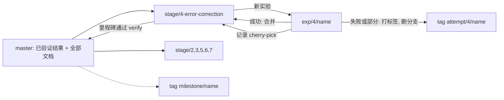

# 七段路线图与开发约定

状态截至 2026-10-10。这里的“段”是能力路线，与代码里的 L1–L5 层级不是一一对应关系。详细结果见各段状态页；完整技术说明见 [README.zh-CN.md](../README.zh-CN.md)。

## 新架构

[闭环架构设计](ARCHITECTURE.md) 已于 2026-10-10 全部定稿，是闭环第一版的设计依据。第 2 段的有向通道演化路线收线，后续由当前状态 E、变化误差 N/M、时间上下文 C、期待 P、意外 U 和规则单元 R 分工完成。工程在本地集成分支 `stage/loop`、工作区 `s-loop` 上推进；本阶段不推送，闭环第一版通过前不合并进 master，是否合并由用户决定。

## 最终目标

用多层脉冲网络实现“经验 → 规则抽象 → 泛化预测 → 目标规划 → 行为 → 经验”的闭环。

## 七段

### 1. 神经元、突触、赫布学习

- 目标：生物物理可信的神经元、突触和赫布学习，按真实离子流记 ATP。
- 现状：完成，L1–L3 已验证。
- 完成判据：`verify/L1-neuron.mjs`、`verify/L2-synapse.mjs`、`verify/L3-hebbian.mjs` 全部通过。
- 分支：无；本段已完成。
- 关键标签：`milestone/L1-L5-base`。
- [状态与复现](stages/1-neuron-synapse-hebbian/STATUS.md)

### 2. 脉冲网络

- 目标：有选择性的吸引子学习，使用 GB_RATE、组内连接加密和只在刺激期学习的门控。
- 现状：部分完成。输入驱动的吸引子和已验证的一步有向通道保留；有向通道演化链 v1–v3 已记录，有向通道演化路线已收线，转入闭环架构的 E1。
- 完成判据：[架构文件](ARCHITECTURE.md)第 5.1 节的 E1 验收：每组组内 / 组间比 ≥ 2；补全 ≥ +0.5 Hz，且至多一组不为正；G = 0.6 时静息点燃率 ≤ 5%。
- 分支：`stage/2-spiking-network`。
- 关键标签：`milestone/L1-L5-base`、`milestone/spiking-emergence`。
- [状态与复现](stages/2-spiking-network/STATUS.md)

### 3. 规则抽象

- 目标：按后果归类情境，关注能预测后果的特征，并在新情境中按规则预测。
- 对应的架构模块：E2 范畴与 R 规则单元。
- 现状：部分完成。脉冲版已实现共现绑定的物体级吸引子；前馈仍是固定的按组拓扑投射，按结果对齐的抽象只在速率版。
- 完成判据（草案）：前馈可学，脉冲版复现规则提取的陷阱测试。
- 分支：`stage/3-rule-abstraction`。
- 关键标签：`milestone/uat-two-layer`、`milestone/rule-extraction-rate`、`milestone/multilayer-spiking`。
- [状态与复现](stages/3-rule-abstraction/STATUS.md)

### 4. 规则误差校对

- 目标：预测与证据比较，误差修正状态并驱动学习，让预测变对。
- 对应的架构模块：第一级误差 N/M 与期待、第二级误差 P/U。
- 现状：部分完成，当前主攻。物体级校对（L4f 10 项通过）、误差层面的序列期待（8.3 Hz）和负误差细胞已实现；产生预测的通路尚未用误差驱动的规则学对。
- 完成判据（草案）：至少 3 个种子上 X→Y 明显高于无关连接，学到的期待超出噪声；深层在 X 期间表达“接下来是 Y”。
- 分支：`stage/4-error-correction`。
- 关键标签：`milestone/predictive-coding`、`milestone/sequence-expectation`；尝试标签为 `attempt/4/apical-feedback`、`attempt/4/deep-population-v0`、`attempt/4/theta-adp`、`attempt/4/checkpoint-variants`、`attempt/4/negative-error`、`attempt/4/handover`、`attempt/4/deep-predictive`。
- [状态、诊断与下一步](stages/4-error-correction/STATUS.md)

### 5. 目标规划

- 目标：保持目标，用学到的前向模型评估候选动作并选择通向目标的动作；包括模拟态与仲裁。
- 对应的架构模块：模拟与规划，留到闭环第一版之后。
- 现状：脉冲版未开始，L5 有速率版零件。工作副本方案是设计草案，前提是第 4 段的深层先学对。
- 完成判据（草案）：模拟在不打断感知的前提下推进 1–3 步，并能按目标选择动作。
- 分支：`stage/5-planning`。
- 关键标签：`milestone/L1-L5-base`（速率版零件）。
- [状态与设计草案](stages/5-planning/STATUS.md)

### 6. 行动层

- 目标：动作改变后续输入，动作副本指导前向模型，与环境形成闭环。
- 对应的架构模块：动作通道。
- 现状：未开始，只有速率版 PFL3 转向读出。
- 完成判据（草案）：在动作触发的小世界里形成闭环，按结果学会选动作并及时预测。
- 分支：`stage/6-action`。
- 关键标签：`milestone/L1-L5-base`（PFL3 速率读出）。
- [状态与下一步](stages/6-action/STATUS.md)

### 7. 通用感知层

- 目标：用通用感知前端取代手工定义的组刺激。
- 现状：未开始。
- 完成判据（草案）：至少一种真实感觉输入（如图像或声音）经感知层形成吸引子，并接入上层。
- 分支：`stage/7-perception`。
- 关键标签：尚无本段里程碑。
- [状态](stages/7-perception/STATUS.md)

## 贯穿各段

每层同时记录代谢（ATP）与动力学两本能量账。能量预算和来源见 [README.zh-CN.md](../README.zh-CN.md) 开头。

## 分支、标签与工作区约定

- `master`：已验证的结果与全部文档，文档以 master 为准。
- 每个未完成的段一条集成分支：`stage/2-spiking-network`、`stage/3-rule-abstraction`、`stage/4-error-correction`、`stage/5-planning`、`stage/6-action`、`stage/7-perception`。第 1 段已完成，不建分支。
- 闭环第一版单独使用 `stage/loop` 集成分支；按闭环工程计划执行各工作包及停止条件，全程仅在本地保存分支和标签。
- `exp/<段>/<名字>`：一个实验一条分支。成功时用 `--no-ff` 合并进对应 stage；失败或部分成功时打附注标签 `attempt/<段>/<名字>`，保留尝试记录，再删除 exp 分支。`exp/` 与 `attempt/` 使用不同前缀。
- `milestone/<名字>`：已完成里程碑的附注标签。
- `cache-2026-10-06`：训练缓存 Release 的标签，由 `gh release create` 生成。
- 每次尝试一页 Markdown，放在对应段的 `attempts/` 下，在 exp 分支上单独提交记录。结束时把记录提交 cherry-pick 到 stage；随后随 stage 合并进入 master。成功实验的合并已包含记录。
- 各段 `STATUS.md` 只在对应 stage 分支上改；本次初始化在 master 上写。`docs/ROADMAP.md` 只在 master 上改。



本地工作区如下。GitHub 上看到的是分支、标签与文档。

| 本地路径 | 分支 | cache |
| --- | --- | --- |
| `D:\kimi_kairos\bio-brain` | `master` | 主缓存 |
| `D:\kimi_kairos\bio-brain-wt\s-loop` | `stage/loop` | 联接主缓存 |
| `D:\kimi_kairos\bio-brain-wt\s2-network` | `stage/2-spiking-network` | 联接主缓存 |
| `D:\kimi_kairos\bio-brain-wt\s3-abstraction` | `stage/3-rule-abstraction` | 联接主缓存 |
| `D:\kimi_kairos\bio-brain-wt\s4-error` | `stage/4-error-correction` | 联接主缓存 |
| `D:\kimi_kairos\bio-brain-wt\s5-planning` | `stage/5-planning` | 联接主缓存 |
| `D:\kimi_kairos\bio-brain-wt\s6-action` | `stage/6-action` | 无共享联接 |
| `D:\kimi_kairos\bio-brain-wt\s7-perception` | `stage/7-perception` | 无共享联接 |

实验工作区命名为 `D:\kimi_kairos\bio-brain-wt\e<段>-<名字>`。共享联接指向 `D:\kimi_kairos\bio-brain\cache`。改了网络构造的实验应先移除联接本身，改用自己的 `cache/`；不要删除主缓存里的文件。缓存的下载与版本对应关系见 [CACHE.md](CACHE.md)。

## 实验流程

下面的命令按第 4 段举例，`<名字>` 和提交占位符需换成实际值。stage 已在自己的工作区检出，因此合并与 cherry-pick 在该工作区执行。

```powershell
# 开始实验；接深层实验时，最后的起点改为 attempt/4/deep-predictive
git worktree add ..\bio-brain-wt\e4-<名字> -b exp/4/<名字> stage/4-error-correction
# 在实验工作区写 attempts/<名字>.md：状态进行中、目标、假设、完成判据
# 单独提交初始记录；结束时补写结果、结论，再单独提交结果记录

# 成功：在 stage 工作区合并，记录随合并保留
git -C ..\bio-brain-wt\s4-error merge --no-ff exp/4/<名字>

# 失败或部分成功：在实验工作区给实验末端打标签并推送
git -C ..\bio-brain-wt\e4-<名字> tag -a attempt/4/<名字> -m "<一句话结论>"
git push origin attempt/4/<名字>
# 若记录分成初始与结果两个提交，按顺序挑拣两次；已有完整单次记录时只挑拣该次
git -C ..\bio-brain-wt\s4-error cherry-pick <初始记录提交> <结果记录提交>

# 确认实验工作区干净、记录与实验已保留，再移除工作区和实验分支
git worktree remove ..\bio-brain-wt\e4-<名字>
git branch -D exp/4/<名字>

# 一段的里程碑在 stage 工作区通过 verify 后，于主工作区合并
git merge --no-ff stage/4-error-correction
git tag -a milestone/<名字> -m "<说明>"
git push origin master stage/4-error-correction milestone/<名字>
```

第 4 段的下一项是 `three-factor-cue`，仅为计划，尚未建立实验分支或运行实验。细节见[状态页](stages/4-error-correction/STATUS.md)。
