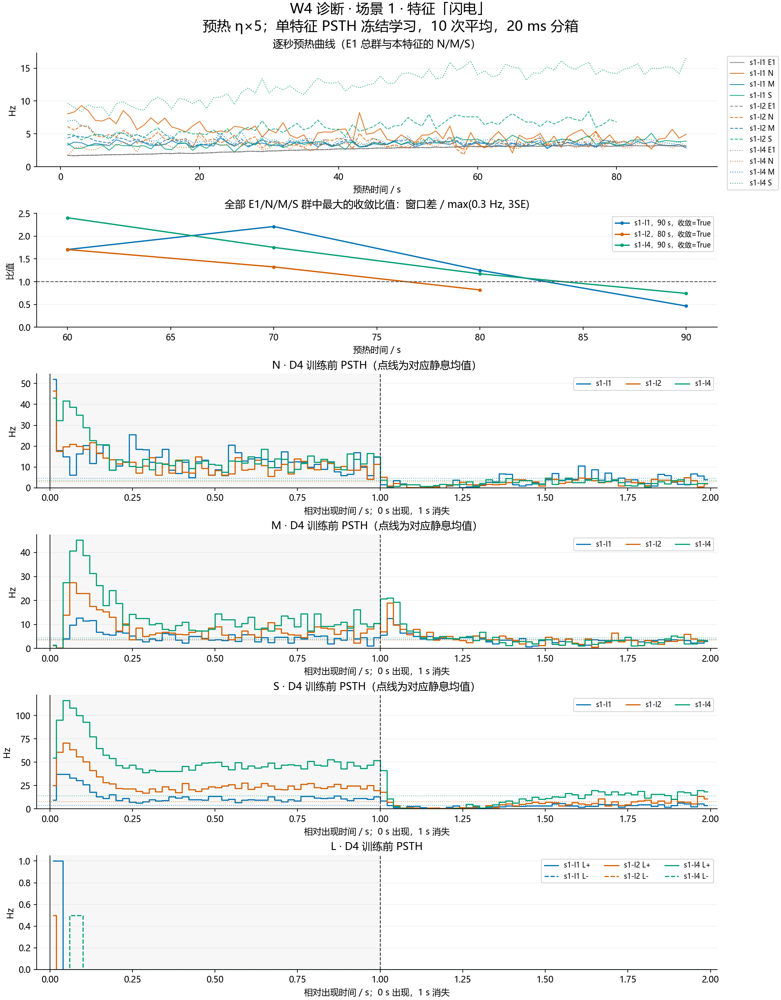
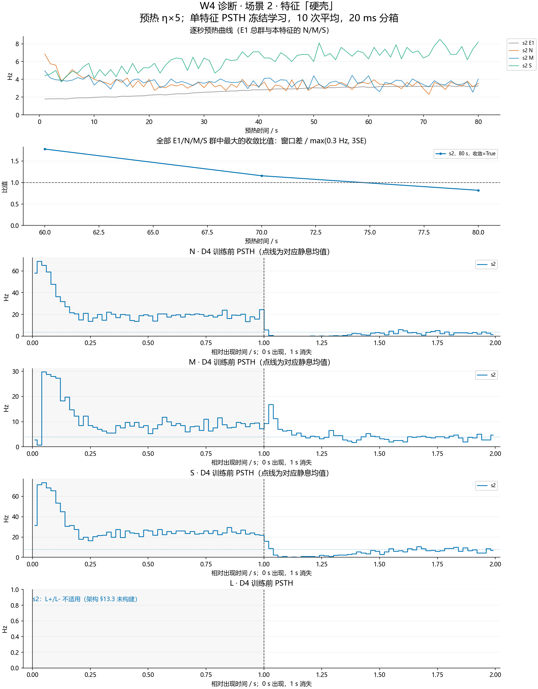
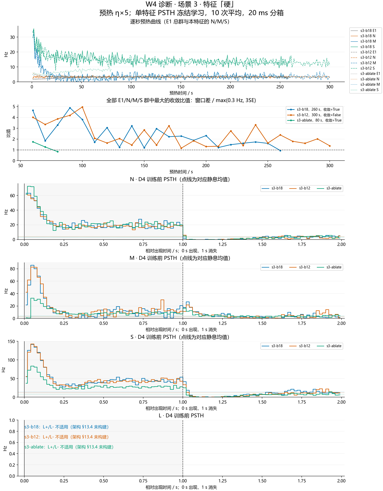
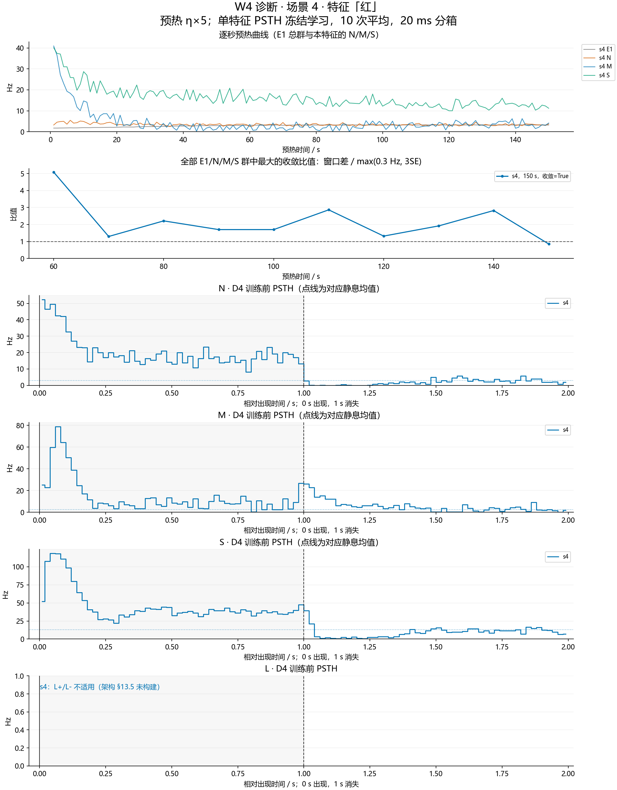

# W4-diag：局部保持与 E2 稳态的完整诊断

状态：诊断全部结束，未满足进入 W4-r4 的条件；按计划第 4 节停止。

设计依据：master `bb1cd07`；架构同步提交 `138e6a0`。执行计划：`C:\Users\86139\.cursor\plans\闭环架构第一版_W4诊断_6f2a91d4.plan.md`。初始记录单独提交 `5032fe6`。

W4-r3 的 I2→E2 目标 3 Hz 与 E2 静息上限冲突，场景一空闲原型池无法提供保持预测。本轮按新版设计加入每特征 E1→S1/M1 的 NMDA 局部通路（入度 24，强度 1/2/4 固定网格），I2→E2 目标 1 Hz，其余 ISTDP 目标 3 Hz，E2 递归 4.5、背景 18/12 固定网格；消融同时关闭 E2→S1/M1。只改计划指定的 12 个代码文件，诊断源码不合并。

主工作区原有第 13.2 节的一行补充说明保持原样，未纳入本轮提交。用户明确：测量已有 L；未构建的 L 标为“不适用”，注明架构 §13.3–13.5 的通道依据。

## 统计与执行完整性

八个固定运行均完成 D1–D9；空原型池跳过 D7。网络种子 43，训练顺序种子 20261011，无额外参数搜索。D6 训练前测量紧接 D3；D4 用每组 10×1 s，D6 用每组 5×10 s，D5 用每组 30 次且只开 ISTDP、η×5。场景三默认点与消融点另测训练后 D4，以检查消融的第 6.4 节第 1–3 条。

PSTH 跨试次平均，小于 40 细胞的群用 20 ms 分箱。静息 θ 从同状态的 2 s 分箱估计：max(μ+4σ, μ+5 Hz)。短窗均值按分箱与窗口重叠时长加权；峰值取中心落在窗口内的分箱。均值差用泊松 3SE，保持均值差容许 max(1 Hz,3SE)，超阈比例上限为 2×静息比例+0.01。静息比例为零时不计算有限倍数，明确显示 Infinity 或 0/0，门槛仍以绝对比例检查。L 的持续频率与静息按 §4.3 的 max(0.3 Hz,3SE) 比较。

汇总表另从 D7 原始结果补列训练后各 E2 单元的静息频率与 θ，便于核对浅响应判断使用的基线；补表不改变运行标志或第 4 节准入结论。诊断脚本的原始汇总（本地证据：`summary-runner.json`，未上传） 同时保留。

预检与逐位恢复证据（本地证据：`diagnostic-self-test.json`，未上传）、学习协议恢复证据（本地证据：`protocol-resume-results.json`，未上传）、八个进程退出码（本地证据：`process-exit-results.json`，未上传）、缓存完整性（本地证据：`cache-integrity.json`，未上传）、范围与标签保持（本地证据：`hygiene.json`，未上传）。既有 161 个文件及 S0 的 114 个文件哈希均未变；新增 42 个缓存全部以 loop- 开头。NaN、程序崩溃或逐位恢复失败均未发生。

## 进入正式验收的判断

| 运行 | 预热秒数 | 收敛 | 静息失败群数 | 静息条件 | 峰值 | 保持 | L 持续 | E2 浅 | 消融条件 | 墙钟秒/模拟秒 |
| --- | --- | --- | --- | --- | --- | --- | --- | --- | --- | --- |
| s1-l1 | 90 | 通过 | 5 | 未达标 | 未达标 | 未达标 | 通过 | 不适用 | 不适用 | 19.0036 |
| s1-l2 | 80 | 通过 | 3 | 未达标 | 通过 | 未达标 | 通过 | 不适用 | 不适用 | 18.0172 |
| s1-l4 | 90 | 通过 | 5 | 未达标 | 通过 | 未达标 | 通过 | 不适用 | 不适用 | 19.3028 |
| s2 | 80 | 通过 | 5 | 未达标 | 未达标 | 未达标 | 不适用 | 不适用 | 不适用 | 26.0608 |
| s3-b18 | 260 | 通过 | 12 | 未达标 | 通过 | 未达标 | 通过 | 未达标 | 不适用 | 27.8474 |
| s3-b12 | 300 | 未达标 | 6 | 未达标 | 通过 | 未达标 | 通过 | 未达标 | 不适用 | 25.3168 |
| s3-ablate | 80 | 通过 | 4 | 未达标 | 通过 | 未达标 | 通过 | 未达标 | 未达标 | 25.8726 |
| s4 | 150 | 通过 | 8 | 未达标 | 通过 | 未达标 | 通过 | 不适用 | 不适用 | 15.5867 |

判断：没有满足第 4 节全部条件的同一组参数点。停止后续 W4-r4 与 W6–W8，不再改参数或规格。

全部静息失败群（含实测值与范围）以及各短窗、保持、负荷和 E2 指标均列在下表，并保存在 汇总 JSON（本地证据：`summary.json`，未上传）。

关键未达标项：八个点的静息范围全部未通过，共 48 个失败群；s3-b12 在 300 s 内未收敛。场景一强度 1 的三个 M1 消失峰值未达标；强度 2、4 与场景四的峰值通过，但保持仍未通过。场景四八个 N1、七个 M1 的长呈现均值差超出各自容差。

场景三六个已提交原型在两种背景下都满足响应频率与返回时间，但训练后的静息未全部合格：背景 18 的木棍/核桃/软地面为 2.075/0.300/0.350 Hz，背景 12 的核桃/软地面为 0.425/2.250 Hz，要求 0.5–2 Hz。消融在训练后仍有峰值、短窗回落与保持失败，例如裂开 M1 的消失峰值 12 Hz < 13.375 Hz。已有 L 的持续频率检查均通过，未构建的方向标为不适用。

以上结论只覆盖计划指定的八个参数点，未穷尽连续参数空间；按第 4 节停止，不继续标定或修改规格。

## D8：默认与消融的保持对照

两点各自完成预热与训练，差值各自相对同状态的静息基线。下表为训练后 150 ms–10 s 的均值差 / 容差（Hz），以差值绝对值判断；超阈比例、峰值和短窗回落见完整对照表。

| 特征 | 默认 N1 | 消融 N1 | 默认 M1 | 消融 M1 |
| --- | --- | --- | --- | --- |
| 硬 | 4.46180 / 1（未达标） | 3.86992 / 1（未达标） | 0.129188 / 1（通过） | 3.03845 / 1（未达标） |
| 硬壳 | 3.42297 / 1（未达标） | 3.94112 / 1（未达标） | 1.32893 / 1（未达标） | -0.0336294 / 1（通过） |
| 裂开 | 3.88756 / 1（未达标） | 4.39518 / 1（未达标） | 1.09569 / 1（未达标） | 1.20228 / 1（未达标） |

## 图与原始数据

图、完整对照表和原始 JSON 同时保存在独立工作区的 结果目录（本地证据：`w4-diag`，未上传），实验工作区清理后仍可直接打开；源码与全部日志按下述本地标签归档。

- s1-l1 完整原始结果（本地证据：`s1-l1-results.json`，未上传）：逐秒曲线、全部检查、每次呈现、放电计数、PSTH、D1 逐通路结构、D5 训练顺序、D7 原型响应与 D8 对照。
- s1-l2 完整原始结果（本地证据：`s1-l2-results.json`，未上传）：逐秒曲线、全部检查、每次呈现、放电计数、PSTH、D1 逐通路结构、D5 训练顺序、D7 原型响应与 D8 对照。
- s1-l4 完整原始结果（本地证据：`s1-l4-results.json`，未上传）：逐秒曲线、全部检查、每次呈现、放电计数、PSTH、D1 逐通路结构、D5 训练顺序、D7 原型响应与 D8 对照。
- s2 完整原始结果（本地证据：`s2-results.json`，未上传）：逐秒曲线、全部检查、每次呈现、放电计数、PSTH、D1 逐通路结构、D5 训练顺序、D7 原型响应与 D8 对照。
- s3-b18 完整原始结果（本地证据：`s3-b18-results.json`，未上传）：逐秒曲线、全部检查、每次呈现、放电计数、PSTH、D1 逐通路结构、D5 训练顺序、D7 原型响应与 D8 对照。
- s3-b12 完整原始结果（本地证据：`s3-b12-results.json`，未上传）：逐秒曲线、全部检查、每次呈现、放电计数、PSTH、D1 逐通路结构、D5 训练顺序、D7 原型响应与 D8 对照。
- s3-ablate 完整原始结果（本地证据：`s3-ablate-results.json`，未上传）：逐秒曲线、全部检查、每次呈现、放电计数、PSTH、D1 逐通路结构、D5 训练顺序、D7 原型响应与 D8 对照。
- s4 完整原始结果（本地证据：`s4-results.json`，未上传）：逐秒曲线、全部检查、每次呈现、放电计数、PSTH、D1 逐通路结构、D5 训练顺序、D7 原型响应与 D8 对照。

诊断运行经过 33404.5 s；实现与预检经过 1521.10 s。各运行 D9 包含构建、计算与检查点写入的活动墙钟时间，重启等待不计入；计时明细（本地证据：`execution-timing.json`，未上传）。

## 完整设计对照表

完整表格分为以下部分。每一行数值和判定保持原样。

- [第 1/17 部分](../reports/w4-diag/tables/table-01-part-01.md)：1143 行。
- [第 2/17 部分](../reports/w4-diag/tables/table-01-part-02.md)：1365 行。
- [第 3/17 部分](../reports/w4-diag/tables/table-01-part-03.md)：1219 行。
- [第 4/17 部分](../reports/w4-diag/tables/table-01-part-04.md)：1178 行。
- [第 5/17 部分](../reports/w4-diag/tables/table-01-part-05.md)：1313 行。
- [第 6/17 部分](../reports/w4-diag/tables/table-01-part-06.md)：1317 行。
- [第 7/17 部分](../reports/w4-diag/tables/table-01-part-07.md)：1317 行。
- [第 8/17 部分](../reports/w4-diag/tables/table-01-part-08.md)：1233 行。
- [第 9/17 部分](../reports/w4-diag/tables/table-01-part-09.md)：1143 行。
- [第 10/17 部分](../reports/w4-diag/tables/table-01-part-10.md)：1339 行。
- [第 11/17 部分](../reports/w4-diag/tables/table-01-part-11.md)：1247 行。
- [第 12/17 部分](../reports/w4-diag/tables/table-01-part-12.md)：1106 行。
- [第 13/17 部分](../reports/w4-diag/tables/table-01-part-13.md)：1307 行。
- [第 14/17 部分](../reports/w4-diag/tables/table-01-part-14.md)：1228 行。
- [第 15/17 部分](../reports/w4-diag/tables/table-01-part-15.md)：1321 行。
- [第 16/17 部分](../reports/w4-diag/tables/table-01-part-16.md)：1269 行。
- [第 17/17 部分](../reports/w4-diag/tables/table-01-part-17.md)：797 行。

## 本地归档

附注标签 `attempt/loop/w4-diag` 保存代码、全部证据与本记录。只挑拣初始和最终记录至 stage/loop，STATUS 单独更新；诊断代码不合并，删除实验工作区与分支，主缓存全部保留。既有标签保持不变；不推送，不合并 master，不改写历史。图与日志归档后可用 `git archive --format=zip --output=w4-diag-evidence.zip attempt/loop/w4-diag experiments/logs/2026-10-11-loop-w4-diag/` 提取，二进制图片也包含在 ZIP 中。
