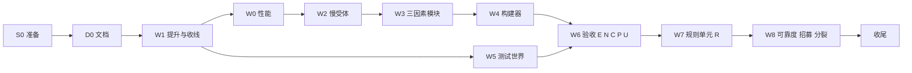

# 闭环架构第一版：工程计划

## 0. 依据与读法

- **设计依据**：master 上的 `docs/ARCHITECTURE.md`（提交 76b5179）。本计划只规定执行顺序、改动范围、验收与停止条件；设计、参数与验收数值一律以架构文件为准。**开始前完整读一遍架构文件。**
- **背景**：只需读架构文件第 2 节。第 2 段 v1–v3（标签 `attempt/2/attractor-chain`、`-v2`、`-v3`）与第 4 段的记录是其依据，不需要重做。
- **环境**：Windows、PowerShell、Node ≥ 20，零依赖；16 个逻辑 CPU。

## 1. 总规则

1. **不推送。** 不执行 `git push`、`gh release` 或任何远程操作；分支与标签都只在本地。
2. **git 卫生**：
   - 不用 `git add -A` 或 `git add .`，按文件路径添加；
   - 不提交 `cache/`、`scratch/`、`.cursor/`、`node_modules/`；
   - 不强推、不 rebase、不改写历史。
3. **改动范围。** 每个包只改其"改动范围"列出的文件。需要改范围以外的文件时，停止并报告。
4. **不改设计。** 只能标定架构文件里写明"标定"的量，并且只能在给定范围内；每次标定（取值、结果）都写进该包的结果 JSON。需要改设计或超出范围时，停止并报告。
5. **逐位一致。** 凡要求"逐位相同"的检查，放电时刻与全部状态数组必须完全相同；能量账（ATP）允许相对误差 ≤ 1e-12（只来自求和顺序）。
6. **缓存。**
   - 新缓存一律以 `loop-` 开头；
   - S0 记录主缓存中全部已有文件的 SHA-256，收尾时逐个核对，必须全部不变；
   - 不删除主缓存里的任何文件。
7. **长任务。**
   - 超过 30 分钟的运行要写检查点，并能精确续算；
   - 日志写到 `experiments/logs/2026-10-xx-loop-<包名>/`（xx 取实际日期）；
   - 并行进程不超过 15 个。
8. **停止条件**见第 6 节。遇到停止条件就按第 2.3 节收尾这个包，不再进行后续的包，向用户报告。

## 2. 分支、工作区与记录

### 2.1 集成分支

- 集成分支为 `stage/loop`，工作区为 `D:\kimi_kairos\bio-brain-wt\s-loop`。
- 闭环第一版通过之前，`stage/loop` 不合并进 master，是否合并由用户决定。

### 2.2 每个包的流程（以 W1 为例）

```powershell
git -C D:\kimi_kairos\bio-brain worktree add ..\bio-brain-wt\e-loop-w1 -b exp/loop/w1-promote stage/loop
New-Item -ItemType Junction -Path D:\kimi_kairos\bio-brain-wt\e-loop-w1\cache -Target D:\kimi_kairos\bio-brain\cache
```

- 在实验工作区写记录 `docs/loop/attempts/<包名>.md`：状态"进行中"，内容为目标、改动范围、验收条目（从本计划抄入），单独提交。
- 完成后补写实测与结论，再单独提交。

### 2.3 收尾一个包

- **通过**：在 s-loop 工作区执行 `git merge --no-ff exp/loop/<包名>`，更新 `docs/loop/STATUS.md` 并单独提交，然后删除实验工作区与分支。
- **未通过**：
  1. 在实验工作区打附注标签 `attempt/loop/<包名>`（只在本地）；
  2. 把两次记录提交挑拣进 `stage/loop`；
  3. 更新 STATUS，删除实验工作区与分支；
  4. 停止整个计划。

### 2.4 执行顺序



- W1、W0、W2 都改 `spiking-network.mjs`，必须依次进行，后一个从前一个合并后的 `stage/loop` 开分支。
- W5 可以在 W1 合并后与 W0–W4 并行。

## 3. 准备与文档

### S0 准备

```powershell
cd D:\kimi_kairos\bio-brain
git status --short          # 必须为空
git log --oneline -1        # 必须是 76b5179
git branch stage/loop 76b5179
git worktree add ..\bio-brain-wt\s-loop stage/loop
New-Item -ItemType Junction -Path ..\bio-brain-wt\s-loop\cache -Target D:\kimi_kairos\bio-brain\cache
```

- 在 s-loop 工作区写 `experiments/logs/2026-10-xx-loop/cache-before.json`：主缓存中每个文件的名称、大小、SHA-256。单独提交。
- 新建 `docs/loop/STATUS.md`：目标（链接架构文件）、工作包表（全部"未开始"）、分支与工作区。单独提交。
- 验收：
  - `git worktree list` 中有 `s-loop [stage/loop]`；
  - 清单覆盖主缓存的全部文件；
  - 两个工作区的 `git status --short` 都为空。

### D0 文档

- **master**（主工作区）改 `docs/ROADMAP.md`，只改这个文件，单独提交：
  - 开头加一段"新架构"，链接 `docs/ARCHITECTURE.md`；
  - 第 2 段：目标改为"有选择性的吸引子学习"（GB_RATE、组内加密、只在刺激期学）；现状写明 v1–v3 已记录、有向通道演化路线已收线；完成判据改为架构文件第 5.1 节的 E1 验收；
  - 第 3–6 段各加一行"对应的架构模块"：第 3 段对应 E2 范畴与 R，第 4 段对应 N/M 与 P/U，第 5 段对应模拟与规划（以后），第 6 段对应动作通道；
  - 分支与工作区表加入 `stage/loop` 与 `s-loop`。
- **stage/2**（`s2-network` 工作区）改 `docs/stages/2-spiking-network/STATUS.md`，单独提交：
  - 有向通道演化路线收线，附 v1–v3 的一句话结论与记录链接；
  - 下一步改为"转入闭环架构，本段以 E1 的吸引子学习收尾"。
- 验收：两个提交存在；各工作区 `git status --short` 为空；没有推送。

## 4. 工程包

### W1 提升与收线（`exp/loop/w1-promote`）

**改动范围：**

- 从标签取出四个文件（它们与 master 的差别只有 v2 的改动）：

  ```powershell
  git checkout attempt/2/attractor-chain-v2 -- src/L3-plasticity/calcium-rule.mjs src/L4-network/spiking-network.mjs verify/L3-hebbian.mjs verify/L4-emergence.mjs
  ```

- 新建 `src/loop/e1.mjs`：从标签上的 `demo/attractor-chain.mjs` 只抽出可复用部分，其余不带：
  - 抽出：`CONFIG`（改名为 `E1_DEFAULTS`）、`RULES`、组与原型的辅助函数、`buildChain`（改名为 `buildE1`，随机数的消耗顺序不变）、`setGain`、`run`（含刺激期学习的门控）、`variant`、`resumableRng`、`captureRuntime` / `restoreRuntime`、`groupBins`、`mean`；
  - 不带：序列、标定、试次、对照与作图。
- 从标签移植 `demo/rate-rule.mjs` 与 `verify/L4-rate-rule.mjs`：导入改为 `src/loop/e1.mjs`；缓存前缀改为 `loop-rate-rule-`，让它重新计算而不是读旧缓存。
- `verify/all.mjs` 只加入 L4h（FAST 模式下跳过），不加入 L4g。
- 删除 `demo/handover.mjs`；删除 `src/L4-network/layered-network.mjs` 中的 `upperGain`、`upperTauN`、`upperAdapt`（代码与注释）。
- 新增 `figures/rate-rule-results.json`（由移植后的 demo 生成）。

**验收：**

1. `node verify/L3-hebbian.mjs` 退出码为 0。
   - GB_RATE 的 60 次配对，与参考值相差均 ≤ 0.005：Δt = +10 ms 时，1 Hz −0.074、5 Hz −0.113、10 Hz −0.122、20 Hz +0.040、40 Hz +0.112；20 Hz、Δt = −10 ms 时 −0.119。
   - GB_NMDA 在 1 Hz、+10 ms 时为 +0.053，相差 ≤ 0.001。
2. `node verify/L4-emergence.mjs` 退出码为 0，其中包括 GB_RATE 的逐拍对拍。
3. `node verify/L4-rate-rule.mjs` 退出码为 0。重新生成的 `figures/rate-rule-results.json` 与标签上的同名文件逐项比较，每个数值相差 ≤ 1e-12，以此证明 `buildE1` 复现了 `buildChain`。
4. `git grep -n -E "upperGain|upperTauN|upperAdapt"` 没有输出；`demo/handover.mjs` 已删除。
5. 完整的 `npm run verify` 退出码为 0。

**预计耗时**：约 3 小时（含完整回归约 50 分钟、规则复算约 30 分钟）。

### W0 性能（`exp/loop/w0-perf`）

**改动范围**：`src/L4-network/spiking-network.mjs`、`src/core/ledger.mjs`；新增 `experiments/bench-spiking.mjs`。

**步骤：**

1. 改动前测速：
   - 用 `src/loop/e1.mjs` 的默认 E1 网络（900 个神经元，学习打开）模拟 2 s；
   - 用 `verify/L4-emergence.mjs` 使用的网络模拟 2 s；
   - 记录每模拟 1 s 所需的墙钟秒数，写入 `bench-before.json`。
2. 改动前记录参考摘要，三种配置：
   - E1 网络学习 2 s；
   - `demo/fig2-network.mjs` 的 GB_NMDA 网络 1 s；
   - `demo/predictive-hierarchy.mjs` 的预测编码网络 0.5 s。

   每种配置记录放电时刻、最终的 V / w / ρ / scale 等全部状态数组的 SHA-256，以及能量账各项。
3. 用 `node --cpu-prof` 剖析后优化，只做不改变动力学运算顺序的改动，例如：
   - 合并能量账的累加；
   - 去掉每步、每个脉冲的临时分配（如每次放电新建的 `Set`）；
   - 把不变量移出循环。

**验收：**

1. 三种配置的放电与状态摘要逐位相同；能量账相对误差 ≤ 1e-12。
2. FAST 回归与完整 `npm run verify` 退出码都为 0。
3. 记录提速。目标是 E1 网络快 ≥ 20%。不到 10% 不算停止条件，但要在记录里写出剖析结果中最耗时的 5 处。

**预计耗时**：3–4 小时。

### W2 慢受体与完整状态导出（`exp/loop/w2-slow`）

**改动范围**：`src/L4-network/spiking-network.mjs`；新增 `verify/L4-slow.mjs`；`verify/all.mjs` 加入 L4i（FAST 模式下也运行）。

**实现：**

- 架构文件第 7.2 节的 `kind: 'slow'`：每个连接组自带 τR、τD 与自己的电导状态；反转电位 0 mV，无镁阻断；ATP 按 AMPA 的离子比例记账。
- 新增 `exportState()` / `importState()`：覆盖全部动态量，使运行可以精确续算。动态量包括：
  - 膜电位、适应、不应期、外部输入资源；
  - 各受体状态，含慢受体；
  - 各种迹（x、y、y2、nmda、各组的 nm、xs、ys、xsl）；
  - 各组的资源、同时检测钙 z、ρ、scale；
  - 待送达队列、随机数状态、能量账、时间。
- `src/loop/e1.mjs` 的 `captureRuntime` / `restoreRuntime` 改为调用这两个方法。

**验收（`verify/L4-slow.mjs` 的六项）：**

1. 不用慢受体时，与 W0 的参考摘要逐位相同。
2. 单个突触前脉冲之后，电导的时间过程与解析双指数一致：在 10 个采样时刻相对误差 ≤ 1e-6。参数取 τR/τD = 10/30 ms 与 9.2/18.5 s 两组。
3. 同一批突触后神经元上两组动力学不同的慢受体线性叠加，误差 ≤ 1e-9。
4. 慢电流记入能量账的量，等于积分电荷按 AMPA 离子比例换算的结果，相对误差 ≤ 1e-9。
5. 一个同时含慢受体、GB_RATE 可塑性与抑制性可塑性的网络："跑 1 s，导出，导入新网络，再跑 1 s"与连续跑 2 s 逐位相同。
6. FAST 回归与完整 `npm run verify` 退出码都为 0。

**预计耗时**：约 3 小时。

### W3 三因素时间差学习模块（`exp/loop/w3-td`）

**改动范围**：新增 `src/L4-network/step-hooks.mjs`（`onStep` 分发器）、`src/L4-network/three-factor.mjs`、`verify/L4-three-factor.mjs`；`verify/all.mjs` 加入 L4j（FAST 模式下也运行）。

**实现**：架构文件第 8.4 节——资格痕迹 τ_e、由 U↑ / U↓ 组平均频率给出的第三因子（10 ms 平滑）、成对的正负权重（w⁺、w⁻）、每 1 ms 更新、上下限、状态导出 / 导入。接口要留出第 10.4 节"延迟写入"与第 5.2 节"原型更新"两种规则的扩展位置（在 W4、W7 中实现）。

**验收：**

1. 一个手工构造的小网络（注入确定的脉冲与第三因子），Δw 与手算值相差 ≤ 1e-9。
2. δ 为正时 w⁺ 增加、w⁻ 等量减少；上下限生效。
3. 模块关闭时，网络与不挂模块时逐位相同。
4. 导出 / 导入后精确续算。
5. FAST 回归退出码为 0。

**预计耗时**：约 2 小时。

### W4 模块化构建器（`exp/loop/w4-build`，在 W1–W3 之后）

**改动范围**：在 `src/loop/` 下新增以下模块，另新增 `verify/loop-build.mjs`，`verify/all.mjs` 加入 `loop-build`（FAST 模式下也运行）。不改已有的 src 文件。

| 文件 | 内容 |
| --- | --- |
| `e2.mjs` | 范畴单元池、四条共用原型的通路、按重叠加权的侧向抑制、原型学习模块（第 5.2 节） |
| `errors.mjs` | N1、S1、M1、V1（第 6 节） |
| `context.mjs` | L、C（第 7 节） |
| `expect.mjs` | P、Q、Z、D、U↑、U↓ 及其抑制性池（第 8–9 节） |
| `actions.mjs` | 动作通道（第 11 节） |
| `build.mjs` | 按场景只建需要的通道（第 4.5 节） |
| `readout.mjs` | 10 ms 分箱、基线与 θ |

每个模块都提供第 4.4 节的接口。

**验收：**

1. 场景一至四的网络：各群规模与连接结构符合架构文件，打印并保存成表；不存在任何从 E1、E2 到 P、Q 的连接。
2. 确定性：同一种子两次构建，连接的哈希相同；换种子则不同。
3. 场景一的完整网络导出 / 导入后，续跑 200 ms 逐位相同。
4. 每个场景的网络静息 2 s：没有 NaN，各群自发频率在以下范围内：

   | 群 | 范围 |
   | --- | --- |
   | E1 | 2–5 Hz |
   | E1 的抑制性神经元 | 5–20 Hz |
   | N1、M1 | 2–5 Hz |
   | C | ≤ 2 Hz |
   | L | ≤ 0.5 Hz |
   | P、D、U、E2 | ≤ 5 Hz |

   只允许在以下范围内调背景：E1 为 20–32 / 8–16 Hz，bgN 10–18，bgM 8–16，bgS、bgV 6–12，C、P、U、E2 为 0–20 Hz。
5. 原型模块的单元检查：W 更新后，四条通路与侧向抑制的强度都随 W 改写；共现更新与手算一致。
6. FAST 回归退出码为 0。

**预计耗时**：5–8 小时。

### W5 测试世界与工具（`exp/loop/w5-world`，W1 之后即可开始）

**改动范围**：新增 `src/loop/world.mjs`（事件脚本，以及架构文件第 13 节场景一至四的生成器）、`src/loop/decode.mjs`（"过了多久"与身份的解码、U 的积分、边界检测）、`verify/loop-world.mjs`；`verify/all.mjs` 加入 `loop-world`（FAST 模式下也运行）。

**验收：**

1. 固定种子下，生成器符合第 13 节，在下列容差内：
   - 40 场雷雨中，有鸟叫的比例为 50% ± 10%；
   - 场景二的每次呈现恰好是原型中的 4 个特征加 1 个原型以外的特征，预留组合从未进入训练；
   - 场景四中三种叶子各占 1/3 ± 0.08。
2. 解码器在按第 7.4 节窗口模型合成的放电上，能还原已知的时间与身份：时间的中位相对误差 ≤ 0.1，身份正确率 ≥ 99%。
3. FAST 回归退出码为 0。

**预计耗时**：约 3 小时。

### W6 E、N、C、P/U 的验收（`exp/loop/w6-accept`，在 W4、W5 之后）

**改动范围**：

- 新增 `demo/loop-accept.mjs`（`MODE` = `e1` | `e2` | `n` | `c` | `pu` | `all`）；
- 新增 `verify/loop-accept.mjs`（长检查，FAST 模式下跳过，只读结果）；
- 新增 `figures/loop-results.json`；
- 新增图：`figures/fig-loop-c.png`（各档时间细胞的放电与解码），`figures/fig-loop-pu.png`（P 的上升与 U）；
- 新增缓存 `cache/loop-*.json`；
- 第 6c 步通过后，删除 `src/L4-network/layered-network.mjs` 中的 `pcNeg`（M、V、J 及其连接）与 `demo/negative-error.mjs`。

**依次进行，前一步通过才进入下一步：**

| 步骤 | 内容 | 验收 |
| --- | --- | --- |
| 6a | 为场景一至四各自的 E1 特征组训练吸引子 | 架构文件第 5.1 节 |
| 6b | 场景三预先提交原型的 E2 | 第 5.2 节第 1、2 条 |
| 6c | 场景一网络上的第一级误差 | 第 6.4 节第 1–5 条 |
| 6d | 只有 E、N、L、C 的网络 | 第 7.7 节第 1–10 条 |
| 6e | 场景一训练集 A、B 与探测试次 | 第 8.5 节第 1–8 条、第 9.4 节第 1–4 条 |

第 6c 步通过并删除 `pcNeg` 之后，`node verify/L4-predictive.mjs`、`node verify/L4-hierarchy.mjs` 与 FAST 回归的退出码都要为 0。

**允许标定的量**（只限架构文件写明的）：

- L 到 C 的强度（目标是每档群体峰值 20–40 Hz）；
- C 的背景；
- P、D 到 U 的强度（目标是抵消一次标准变化爆发）；
- 三因素规则的 η 与 wMax；
- W4 验收第 4 条列出的背景范围。

**预计耗时**：模拟约 15–25 小时；按场景、按测试并行。

### W7 规则单元 R（`exp/loop/w7-rules`）

**改动范围**：

- 新增 `src/loop/rules.mjs`：12 个单元的固定池、I_R、L_r 与 C_r、触发门控、第 10.4 节的延迟写入学习（经 `step-hooks`）；
- `demo/loop-accept.mjs` 加 `MODE=r`：场景三，以及预先提交 E2 的场景四阶段 1；
- 新增 `verify/loop-rules.mjs`，单元检查部分在 FAST 模式下运行。

**验收**：架构文件第 10.7 节第 1–7 条。

**允许标定**：η_R、触发门控的阈值。ε = 0.1 与预算 0.2 固定不变。

**预计耗时**：6–10 小时。

### W8 可靠度、招募与范畴分裂（`exp/loop/w8-recruit`）

**改动范围**：

- 新增 `src/loop/reliability.mjs`（u、v，第 12.1 节）、`src/loop/recruit.mjs`（E2 与 R 两个池的空闲单元、提交、回收、警戒门槛，第 12.2 节，以及第 12.3 节的分裂检测）；
- `demo/loop-accept.mjs` 加 `MODE=recruit`：
  - 场景一的延迟变更，有、无 v 加速各一遍；
  - 场景二从空池开始；
  - 场景四的阶段 0、阶段 1 及对照；
- 新增 `verify/loop-recruit.mjs`。

**验收**：架构文件第 12.5 节第 1–5 条。

**允许标定**：每个池的 ρ，在 [0.5, 0.85] 内。

**预计耗时**：10–15 小时。

## 5. 收尾

- `docs/loop/STATUS.md` 汇总每个包的状态、关键数字、记录与标签链接，单独提交。
- 缓存核对：写 `cache-after.json` 与 `cache-integrity.json`，S0 清单中的文件必须全部不变。
- `stage/loop` 不合并进 master，不推送。
- 向用户报告：
  - 哪些包通过、在哪里停下、未通过的条目与实测值；
  - 各包实际用时与 W0 的提速。

## 6. 停止条件

出现以下任一情况，按第 2.3 节"未通过"收尾当前的包并停止：

- 任一验收条目在允许的标定之后仍不达标；
- 需要改架构文件里的设计，或参数超出允许范围；
- 需要改本包改动范围以外的文件；
- 任一逐位一致的检查失败；
- 主缓存中已有文件的哈希发生变化。
