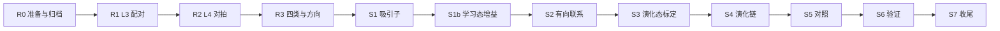

# 有向通道演化链 v2

- 状态：部分成功；S2 两次补救后仍未通过，按停止条件结束。
- 分支：exp/2/attractor-chain-v2。
- 起点：attempt/2/attractor-chain（272e83d）。
- 开始日期：2026-10-09。

本记录在正式模拟前保留 v2 的诊断依据、设计改动、规则实现、全部验收与停止条件。未特别说明的定义和条件沿用第一版尝试记录。仅允许改动 src/L3-plasticity/calcium-rule.mjs 与 src/L4-network/spiking-network.mjs，新增预设不改变默认规则。

诊断归档说明：源目录实际含 21 个 JSON；20 个主要结果加 README 放在指定目录，额外 Cpre=0.55 探索结果存入相邻 extra 目录，全部保留。e0 文件按计划更名并更正参数描述。
### 0.2 2026-10-09 的诊断

诊断为单一种子，在仓库外的临时目录 `C:\Users\86139\AppData\Local\Temp\chain-diag\` 中进行，网络与随机种子照抄第一版。步骤 R0 会把它们归档进仓库。

- **静息噪声学习**：原规则下，不给任何刺激、只开学习，5 s 内所有兴奋→兴奋效能从 0.10 涨到 0.20（正是预算上限），组内、组间、不成组都一样。
- **只在刺激期学习还不够**：原规则下比值 1.43，补全 +0.27 Hz、5/8 组为正。
- **四类突触**：只刺激 A 组 20 次、只在刺激期学、开预算。
  - 原规则：A→A +0.228，A→组外 +0.227，组外→A +0.085，组外→组外 +0.081。
  - 原因：组外神经元有约 3–5 Hz 的自发放电，A 高频放电时，组外的每次零星脉冲都算一次"前先后后"。
- **原因所在**：原规则 `GB_NMDA` 的同时检测项（η = 2）让单次巧合就增强。下面是 60 次配对、Δt = +10 ms 的 Δρ：
  - 原规则：1 Hz +0.053，20 Hz +0.065，40 Hz +0.112，即任何频率都增强；
  - 原规则去掉同时检测项（η = 0）：20 Hz 以下全部减弱，只有 40 Hz 增强；但 40 Hz 时前后两种时序几乎一样（+0.041 / +0.033），方向性丢失，所以不采用。
- **更正**：诊断过程中曾把 `diag-classes-rg-e0-t100.json` 误记为"突触前后钙各 0.6、η = 0"。文件里记录的参数是原值 0.8 / 1.0、η = 0。四类结果为 A→A +0.219、A→组外 +0.063、组外→A +0.058、组外→组外 +0.007。
- **新规则 `GB_RATE`**：突触前后钙各 0.6、η = 1.2，同时检测钙乘以突触后 100 ms 慢速放电迹。
  - 配对 Δρ（Δt = +10 ms）：1 Hz −0.074、5 Hz −0.113、10 Hz −0.122、20 Hz +0.040、40 Hz +0.112；20 Hz、Δt = −10 ms 时为 −0.119。即低频减弱、高频增强，方向保留。
  - 四类：A→A +0.212，A→组外 +0.010，组外→A +0.027，组外→组外 −0.004。
  - 方向（A 40 ms 接 B 40 ms，40 遍，全程学习）：A→B +0.144，B→A +0.089；A、B 到组外 −0.009，组外到 A、B −0.007，组外之间 −0.020。原规则对应为 A→B +0.090、B→A +0.064，而 A、B 到组外 +0.105，组外到 A、B +0.094，组外之间 +0.098。
  - 静息 30 s：所有类别都从 0.10 一起降到 0.069（钙规则自身的双稳态漂移），没有噪声增强。
- **300 次变体复现步骤 1**（比值为各组范围；补全为平均值与为正组数）：
  - 新规则，静息也学：1.42（1.20–1.62），+0.29、5/8，静息点燃 0%；
  - 新规则，只在刺激期学：1.91（1.61–2.26），+0.37、6/8，8%；
  - 原规则，只在刺激期学，组内加密：3.9（3.4–4.5），+10.0、8/8，61%；
  - **新规则，只在刺激期学，组内加密：8.8（8.3–9.1），+6.5、8/8，57%**。
  - "组内加密"指组内连接概率 0.25、组间 0.083，入度不变。8 组均匀连接时，每个神经元只有 8 个组内输入、64 个组间输入，组内驱动只占递归输入约 20%。

### 0.3 设计改动

1. **规则**用 `GB_RATE`，作为可选预设加入 L3 与 L4，默认值不变。
2. **只在刺激期学习**：兴奋→兴奋递归只在刺激窗口（变体的 200 ms、序列的每一项）里学；静息期冻结，并把同时检测钙 `z` 清零。抑制性可塑性全程照常。
3. **组内加密**：组内连接概率 `pIn` = 0.25，组间 `pOut` = 0.083。
4. **学习态递归增益 G_learn**：步骤 1 之后标定（第一版没有这一项）。增益通过同时缩放可塑上下限 `sMin`、`sMax` 实现，学习改写效能时增益才能保住。
5. **演化态增益网格扩展到 1 以下**：G ∈ {0.6, 0.7, 0.8, 0.9, 1.0, 1.2}。


## 2. 规则变体的实现

L3（`calcium-rule.mjs`）：

```js
/** 频率依赖变体：同时检测钙再乘突触后慢速放电迹 y2（时间常数 post2Tau，取本次脉冲之前的值，相当于三联体 STDP 的 o2 项）；
 * 突触前后钙降到 0.6，单次巧合的钙和（1.2）落在减弱区间，只有突触后持续高频放电时才越过增强阈值 */
export const GB_RATE = { ...GB_NMDA, Cpre: 0.6, Cpost: 0.6, eta: 1.2, post2Tau: 100 };
// CalciumPlasticity：构造时 this.y2 = 0; this.postFired = false;
// postSpike()：const f = this.p.post2Tau ? this.y2 : 1; this.c += this.p.Cpost + this.p.eta * this.p.Cpre * this.nmda * f; this.postFired = true;
// step() 末尾（在 c 与 nmda 衰减之后）：if (this.p.post2Tau) this.y2 = this.y2 * Math.exp(-dt / this.p.post2Tau) + (this.postFired ? 1 : 0); this.postFired = false;
```

L4（`spiking-network.mjs`，NMDA 同时检测那一段）：

```js
const y2 = gb.post2Tau ? (this.y2 ??= new Float64Array(N)) : null;
for (const g of this.plastic) {
  if (g.frozen) continue;
  const tr = g.nm ?? this.nmda, eta = g.nm ? (gb.eta * gb.tauN) / g.plastic.tauN : gb.eta;
  for (let i = 0; i < N; i++) {
    if (!fired[i]) continue;
    const f = y2 ? y2[i] : 1;
    if (f === 0) continue;
    for (const k of g.incP[i]) g.z[k] += eta * gb.Cpre * tr[g.pre[k]] * f;
  }
}
if (y2) { const d2 = Math.exp(-dt / gb.post2Tau); for (let i = 0; i < N; i++) { y2[i] *= d2; if (fired[i]) y2[i] += 1; } }
```

两边的顺序必须一致：先用本步之前的 y2 计算同时检测钙，再"先衰减、后加 1"，否则逐拍对拍会失败。不设 `post2Tau` 时 f = 1，结果与原来逐位相同。

## 3. 步骤与验收条件



### R0：准备与归档

- 按第 1 节建工作区。
- **归档诊断**：把临时目录里的 `diag.mjs` 复制为 `experiments/chain-diag.mjs`，`spiking-network-rg.mjs` 复制为 `experiments/spiking-network-rg.mjs`；全部 20 个 `diag-*.json` 复制到 `experiments/logs/2026-10-09-chain-diagnostics/`。
  - 复制时把 `diag-classes-rg-e0-t100.json` 改名为 `diag-classes-gbnmda-eta0.json`。
  - 另写一份 `README.md`：说明每个文件对应的条件，并注明脚本用绝对路径导入，只作存档。
  - 如果临时目录已经不存在，就跳过归档，并在记录里注明。
- **初始记录**：写 `docs/stages/2-spiking-network/attempts/attractor-chain-v2.md`，状态"进行中"，抄入本计划第 0.2、0.3 节和全部验收条件。
- 归档和记录各自单独提交。
- 验收：
  - `git worktree list` 中有 `e2-attractor-chain-v2 [exp/2/attractor-chain-v2]`；
  - `git ls-files experiments/logs/2026-10-09-chain-diagnostics` 共 21 个文件（如果做了归档）；
  - `git status --short` 为空。

### R1：L3 规则变体

按第 2 节实现，并在 `verify/L3-hebbian.mjs` 中加入检查。验收：
1. `node verify/L3-hebbian.mjs` 退出码为 0，原有检查全部通过。
2. `GB_RATE` 的 60 次配对与下列参考值一致，误差 ≤ 0.005：
   - Δt = +10 ms：1 Hz −0.074、5 Hz −0.113、10 Hz −0.122、20 Hz +0.040、40 Hz +0.112；
   - 20 Hz、Δt = −10 ms：−0.119。
3. `GB_NMDA` 不变：1 Hz、+10 ms 仍为 +0.053（误差 ≤ 0.001）。

### R2：L4 快速网络与逐拍对拍

验收：
1. `node verify/L4-emergence.mjs` 退出码为 0，其中 `GB_RATE` 的对拍（放电时刻、每个突触的效能、ATP）逐拍相同。
2. `$env:FAST=1; npm run verify` 退出码为 0。
3. `git diff --stat stage/2-spiking-network -- src` 只列出 `calcium-rule.mjs` 和 `spiking-network.mjs`。

### R3：网络层的规则验收

- **实现**：以 `experiments/chain-diag.mjs` 的 `classes`、`direction`、`rest` 三种模式为蓝本，写 `demo/rate-rule.mjs`：导入改为仓库内的相对路径，规则用 src 里的预设，网络为第一版配置（`pIn` = `pOut` = 0.1，背景 30 / 12 Hz），种子不变。
- **运行**：`GB_RATE`、`GB_NMDA`、`GB_NMDA` 加 `eta: 0` 三种规则都跑一遍，结果写入 `figures/rate-rule-results.json`。
- **验收（GB_RATE）**：
  1. 四类（只刺激 A 20 次，只在刺激期学，开预算）：A→A ≥ +0.15；A→组外 ≤ A→A 的 10%；组外→A ≤ A→A 的 20%；组外→组外 ≤ +0.01。
  2. 方向（A 40 ms 接 B 40 ms，休息 400 ms，40 遍，全程学习）：A→B − B→A ≥ 0.03；A、B 到组外、组外到 A、B、组外之间，平均 Δρ 都 ≤ +0.01。
  3. 静息 30 s（无刺激，全程学习）：各类平均 Δρ ≤ +0.005，并且组内与组间之差 ≤ 0.005。
  4. 对照只记录、不作门槛：原规则四类中 A→组外 ≥ A→A 的 50%；原规则静息 5 s 后平均 ρ ≥ 0.18。
- `node verify/L4-rate-rule.mjs` 退出码为 0。

### S1：吸引子（v2 配置，学习态 G = 1）

- **配置**：规则 `GB_RATE`（替换 `buildChain` 里写死的 `GB_NMDA`）；`pIn` 0.25、`pOut` 0.083；按 0.3 第 2 条只在刺激期学习。
- **新增 `setGain(S, G)`**：先 `S.EE.plastic.sMin = cfg.sMin * G`，`S.EE.plastic.sMax = cfg.sMax * G`，再用 ρ 重算全部 `scale`。用它代替原来的 `EE.scale[k] *= G`。
- **训练**：300 次变体，与第一版相同，缓存为 `cache/chain-v2-attractors.json`。
- 验收：
  1. 训练前，兴奋性 2–5 Hz、抑制性 5–20 Hz、Fano 因子 < 2。背景只允许在 20–32 / 8–16 Hz 内调整。
  2. 每一组的组内 / 组间效能比 ≥ 2（诊断值 8.3–9.1）。
  3. 补全 ≥ +0.5 Hz，且至少 7/8 组为正（诊断值 +6.5、8/8）。
  4. 记录 G = 1 时学习态的静息点燃率（诊断值 57%），这一项不作门槛，交给 S1b 处理。

### S1b：学习态增益标定（不重训）

- 载入 `chain-v2-attractors.json`，对 G_learn ∈ {1.0, 0.9, 0.8, 0.7, 0.6, 0.5} 各测 3 s 静息点燃率（冻结学习）和补全（与 S1 同方法）。
- 验收：存在这样的 G_learn——静息点燃率 ≤ 5%，同时补全 ≥ +0.5 Hz、≥ 7/8 组为正；取其中最大的一个。完整表格写入结果 JSON。

### S2：有向联系（学习态，G_learn）

- 与第一版步骤 2 相同（160 回合，每 2 回合插 1 次变体），但改为在 G_learn 下进行，兴奋→兴奋只在每一项与变体刺激期间学习。缓存为 `cache/chain-v2-main.json`。
- 验收：第一版步骤 2 的第 1–6 条，其中第 5 条在 G_learn 下测量；补救方法也照第一版（先加到 320 回合，再把每项缩短到 30 ms）。

### S3：演化态标定

- 网格为 G ∈ {0.6, 0.7, 0.8, 0.9, 1.0, 1.2} × b ∈ {20, 40, 60, 80} pA，增益仍用 `setGain`。
- 验收：第一版步骤 3 的四条工作点条件。组内加密的备选方案已经用掉，没有工作点就按部分成功收尾。

### S4：演化链主测试

第一版步骤 4 的五条，原样适用。

### S5：对照

- 第一版的 5a–5d 原样适用，其中 5a 用 `chain-v2-attractors.json`，5b 的缓存为 `chain-v2-shuffled.json`。
- **5e 原规则对照**（只记录、不作门槛）：在 v2 的全部设置下（组内加密、只在刺激期学、S1b 选出的 G_learn）用 `GB_NMDA` 重做 S1、S2。记录组内 / 组间比、第一版 2.3 的 Spearman 相关，以及没经历过的有序组对的平均 Δρ，并与 `GB_RATE` 对比。

### S6：验证与回归

- `verify/L4-chain.mjs` 覆盖 S1–S5 的全部检查；`verify/all.mjs` 中有 `L4g` 和 `L4h`，FAST 模式都跳过。
- 验收：
  1. `node verify/L3-hebbian.mjs`、`node verify/L4-emergence.mjs`、`node verify/L4-rate-rule.mjs`、`node verify/L4-chain.mjs` 退出码都为 0。部分成功时，`L4-chain` 要逐条列出哪些未通过。
  2. 因为共享代码改了，完整的 `npm run verify` 退出码要为 0（约 50 分钟）。

### S7：图、文档与收尾

- **图和数据**：
  - `figures/fig13-chain.png` 与 `figures/chain-results.json` 改为 v2 的结果；
  - 保留 `figures/rate-rule-results.json`；
  - 在 `docs/CACHE.md` 中加入 `chain-v2-*` 这一族文件。
- **文档**：
  - 尝试记录补上结果与结论，单独提交；
  - 第 2 段 STATUS 更新现状与尝试列表；
  - 成功时，在 README.zh-CN.md 第 3 层之后新增"频率依赖变体 GB_RATE"一节（配对参考值与原因），在第 4 层（脉冲版）之后新增"有向通道演化链"一节。
- **第 4 段的备注**：在 `s4-error` 工作区，给第 4 段 STATUS 的"下一步"补一句：第 2 段发现原规则在有自发活动的网络里不加选择地增强，深层 v2 的非特异线索和 handover 的反向学习值得用 `GB_RATE` 复查。单独提交并推送。
- **成功**（S1–S4 与 S6 全部通过）：在 `s2-network` 工作区执行 `merge --no-ff exp/2/attractor-chain-v2`，推送 stage 分支，删除 e2 工作区和 exp 分支。
- **失败或部分成功**：打附注标签 `attempt/2/attractor-chain-v2` 并推送；把记录提交挑拣进 `stage/2-spiking-network` 并推送；删除 e2 工作区和 exp 分支。
- 验收：远程分支或标签与本地一致；`git worktree list` 中不再有 e2 工作区。

## 4. 停止条件

遇到以下情况就停下并报告，不要自行改变设计：
- R1、R2、R3 任一不达标：不进入演化链；
- S1 不达标，或 S1b 找不到 G_learn；
- S2、S3 用完补救后仍不达标：按部分成功收尾；
- 需要改动第 1 节以外的 src 文件。

## 5. 预计耗时

总计约 6–8 小时，大部分是模拟：
- R1–R2 约 1 小时（含 `L4-emergence` 4 分钟）；
- R3 约 30 分钟，九次网络测试可以并行；
- S1 约 25 分钟，S1b 约 10 分钟，S2 约 25–50 分钟；
- S3 约 1 小时，可以按 G 值并行；
- S4 约 20 分钟；
- S5 约 2 小时，5b、5e 需要重训；
- S6 的完整验证约 50 分钟。
## 实测结果

### R0–R3：规则前置验证通过

R0 从第一版标签创建独立工作区，20 个主要诊断 JSON 与 README 共 21 个文件，额外的一个探索 JSON 另存且未丢弃。诊断归档与初始记录分别提交。共享缓存联接指向主工作区的 `cache`；开始前记录了原有 50 个缓存的 SHA-256，其中 48 个为发布缓存，两个为第一版链实验。

R1 的 15 项检查通过。60 次配对的实测 Δρ 为：

| 频率 | 时间差 | GB_RATE 实测 | 参考值 |
| --- | --- | --- | --- |
| 1 Hz | +10 ms | −0.074104 | −0.074 |
| 5 Hz | +10 ms | −0.113255 | −0.113 |
| 10 Hz | +10 ms | −0.122163 | −0.122 |
| 20 Hz | +10 ms | +0.040104 | +0.040 |
| 40 Hz | +10 ms | +0.111694 | +0.112 |
| 20 Hz | −10 ms | −0.119254 | −0.119 |

原规则 GB_NMDA 的 1 Hz、+10 ms 结果为 +0.052954。上述误差均在计划范围内。

R2 的 11 项检查通过。GB_DP、GB_NMDA、GB_RATE 分别对拍 30,001 步，放电时刻一致；GB_RATE 的最大效能误差为 1.11×10⁻¹⁶，最大 ATP 相对误差为 2.97×10⁻¹⁶，属于浮点计算顺序的舍入误差。仅改动两个获准的共享 src 文件。规则实现后的 FAST 回归用时 105 s，接入 L4g/L4h 后的 FAST 回归用时 102 s，两次退出码均为 0。

另检查了旧规则未启用选项时的逐位一致性、学习期间 G 保持、兴奋冻结时抑制可塑性继续更新，以及包含 y2 和随机数状态的精确续算，均通过。

R3 的三种规则 × 三种条件共九项结果已保存；GB_RATE 的四项验收全部通过：

| 测量 | 实测 Δρ |
| --- | --- |
| 四类，A→A，预算开启 | +0.212280 |
| 四类，A→组外 | +0.010060（A→A 的 4.74%） |
| 四类，组外→A | +0.027071（A→A 的 12.75%） |
| 四类，组外→组外 | −0.003892 |
| 方向，A→B / B→A | +0.143791 / +0.088846，差 +0.054945 |
| 方向，A/B→组外 / 组外→A/B / 组外→组外 | −0.008927 / −0.007357 / −0.020390 |
| 静息 30 s，组内 / 组间 / 不成组 | −0.031340 / −0.031251 / −0.031525 |

原规则对照只记录：A→组外 / A→A 为 0.991955；静息 5 s 后组内、组间、不成组平均 ρ 为 0.200818 / 0.198704 / 0.203491。预算关闭和 eta=0 的全部数值也保存在 `figures/rate-rule-results.json`。

### S1：吸引子通过

背景保持 30/12 Hz，训练前 E/I=2.034722/5.327778 Hz、Fano=1.663396，通过基线条件。300 次变体按 A–H 分别呈现 42、35、38、34、35、46、36、34 次，训练用时 942.828 s。

| 组 | 组内 / 全体组间平均 ρ |
| --- | --- |
| A | 8.252486 |
| B | 8.846076 |
| C | 9.106713 |
| D | 8.217145 |
| E | 9.030915 |
| F | 8.905858 |
| G | 8.768089 |
| H | 8.289200 |

平均比值 8.677060，全部八组超过 2。补全平均 +6.843967 Hz，8/8 组为正。G=1 的学习态静息点燃率为 62.6667%，按 v2 条件只记录，交由 S1b 标定。

### S1b：学习增益通过，选择 G_learn=0.6

六个条件从同一份 S1 权重独立测量，不重训：

| G | 静息点燃率 | 补全增量（Hz） | 正值组数 | 通过 |
| --- | --- | --- | --- | --- |
| 1.0 | 62.6667% | +6.843967 | 8/8 | 否 |
| 0.9 | 28.0000% | +7.634693 | 8/8 | 否 |
| 0.8 | 16.6667% | +5.628906 | 8/8 | 否 |
| 0.7 | 8.0000% | +2.627387 | 8/8 | 否 |
| 0.6 | 2.6667% | +1.820457 | 8/8 | 是 |
| 0.5 | 1.3333% | +0.714554 | 8/8 | 是 |

最大可用值为 0.6，后续序列学习固定使用该值；不根据后续结果再次降低或重选学习增益。

### S2 与后续阶段

初轮 160 回合、40 ms/项未通过。主路径与分叉路径实际呈现 117/43 次；不是预设的整数 3:1。

| 条件 | 最小方向差 / 平均方向差 | C→D / C→G | Spearman / 前七大中的经历连接 | 平均 / 最小吸引子比 | 静息点燃率 | 结果 |
| --- | --- | --- | --- | --- | --- | --- |
| 160 回合，40 ms | 0.013136 / 0.029500 | 0.090340 / 0.096619 | 0.517165 / 4 | 8.568604 / 7.588229 | 3.3333% | 2.1、2.2、2.3 未通过 |
| 320 回合，40 ms | 0.030048 / 0.043758 | 0.093717 / 0.080633 | 0.550187 / 6 | 8.719601 / 7.675264 | 2.0000% | 仅 2.1 的平均方向差未通过 |
| 320 回合，30 ms | 0.020621 / 0.030930 | 0.087715 / 0.072824 | 0.535014 / 5 | 8.987543 / 7.551062 | 3.3333% | 仅 2.1 的平均方向差未通过 |

首次补救从 160 回合完整动力学检查点续算至 320 回合，仍为 40 ms/项，总训练用时 1637.796 s。主路径与分叉路径实际呈现 235/85 次。七条方向差均超过 0.02，但平均 0.043758 低于 0.05，其余四项通过。

第二次也是最后一次补救从 S1 权重重新训练 320 回合，将每项缩短至 30 ms，训练用时 1494.947 s，主/分叉路径仍为 235/85 次。七条方向差均超过 0.02，平均 0.030930 仍低于 0.05，其余四项通过。

| 连接 | 160×40 ms 方向差 | 320×40 ms 方向差 | 320×30 ms 方向差 |
| --- | --- | --- | --- |
| A→B | 0.014060 | 0.030048 | 0.020621 |
| B→C | 0.026289 | 0.043254 | 0.039796 |
| C→D | 0.045641 | 0.057865 | 0.046852 |
| C→G | 0.042166 | 0.042839 | 0.029710 |
| D→E | 0.013136 | 0.042336 | 0.024384 |
| E→F | 0.035176 | 0.055893 | 0.033636 |
| G→H | 0.030034 | 0.034070 | 0.021507 |

两次允许的补救已用尽。最好的 320×40 ms 条件平均方向差为 0.043758，仍未达到 0.05；最后一次补救也未通过。因此按停止条件结束 S2，不运行 S3 标定、S4 自主链或 S5 对照，包括原规则对照 5e。后续未执行条件逐条标记“未运行”。

### S6：验证与回归

单独的 L3-hebbian、L4-emergence、L4-rate-rule 均退出 0。L4-chain 退出 1，逐条报告 18/34 项未通过：S2 的平均方向差和阶段通过条件未达标，16 项后续条件未执行；共享 src 范围检查通过。

完整 `npm run verify` 已执行完，用时 2684 s（进程墙钟 2687.227 s），总退出码为 1。原有十组 L1、L2、L3、L4、L4b、L4c、L4d、L4e、L4f、L5 与新增 L4h 全部通过，唯一失败组为 L4g，与单独检查报告一致。因此原有回归通过，但 S6 的全部退出码为 0 的验收未达成；按部分成功路径归档。完整输出与开始、结束时间保存在标签的 `experiments/logs/2026-10-09-attractor-chain-v2/full-verify.log` 和 `full-verification.json`。

完整回归后核对缓存：开始前的 50 个文件（48 个发布缓存、两个第一版实验缓存）SHA-256 全部不变；新增 15 个 `chain-v2-*` 与九个 `rate-rule-*`，共 74 个文件。新增缓存清单及原有文件哈希对照保存在同目录的 `cache-snapshot.json`、`cache-integrity.json`。

### S7：图、文档与收尾

`figures/rate-rule-results.json` 保留全部九项网络规则测量；`figures/chain-results.json` 保留 S1、六点增益表及三次 S2 的完整权重指标、实际路径与计数。图 13 显示最终 320×30 ms 权重，橙色标记实际经历过的连接；自主链、转移和停留面板均标记未运行。

第 4 段 STATUS 的 GB_RATE 复查备注已独立提交 `ad648a4`，并推送、核对远端。本次采用部分成功收尾：代码、数据、图及日志归档到附注标签 [attempt/2/attractor-chain-v2](https://github.com/vasily-tolkyov/bio-brain/tree/attempt/2/attractor-chain-v2)；初始与最终尝试记录单独提交，随 STATUS、CACHE 文档挑拣到 `stage/2-spiking-network` 并推送。实验工作区和 `exp/2/attractor-chain-v2` 分支在核对远端后移除，共享缓存保留。第 2 段的实验代码由标签保存，master 保持公开发布版本。

## 结论与遗留问题

GB_RATE 在本次固定种子和给定网络条件下通过频率配对、网络噪声选择性及方向验收。组内加密和刺激期学习形成了选择性吸引子；降低学习增益到 0.6 后，同时满足静息和补全要求。

有向联系学到了弱方向性和符合经历的分叉排序，但平均强度不足：两次补救都未达到预先要求的 0.05。增加回合改善了方向性，缩短每项反而降低平均差值；本计划至此停止，没有自持、收尾、自主状态转移或对照的证据。实验仅使用计划允许的两次补救。
