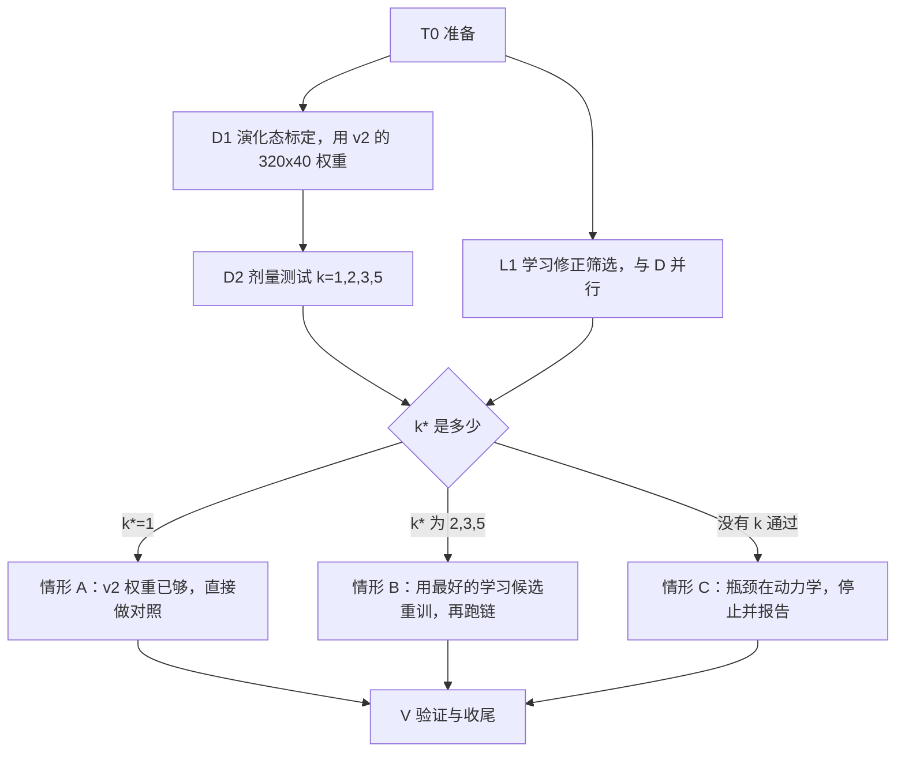

# 有向通道演化链 v3

- 状态：部分成功；D1 无工作点，按情形 C 停止并归档。
- 分支：exp/2/attractor-chain-v3。
- 起点：attempt/2/attractor-chain-v2（fd0b1da）。
- 开始日期：2026-10-09。

本记录在运行前保留计划第 0–4 节及其固定门槛、决策规则与停止条件。

## 0. 依据（v2 实测，供执行者理解，不需要重做）

v2 记录：`D:\kimi_kairos\bio-brain-wt\s2-network\docs\stages\2-spiking-network\attempts\attractor-chain-v2.md`，代码在标签 `attempt/2/attractor-chain-v2`。

- R0–R3、S1、S1b 全部通过：GB_RATE 有选择性；8 个吸引子的组内 / 组间比为 8.2–9.1；学习态增益 G_learn = 0.6。
- S2 未通过，原因只有一项：7 对正向减反向的**平均**差最好为 0.0438，门槛 0.05。
- 三份 S2 状态都在缓存里：`chain-v2-sequence-160-40.json`、`-320-40.json`、`-320-30.json`。下面是它们的组平均 ρ：
  - 160×40：组内 0.404，正向 0.086，反向 0.056，未经历 0.040；
  - 320×40：组内 0.340，正向 0.087，反向 0.043，未经历 0.031；
  - 320×30：组内 0.359，正向 0.077，反向 0.047，未经历 0.033。
- 从这些数据得出的判断：
  1. 正向连接在 160 回合时已到平衡（约 0.087）。方向差的增长来自反向衰减，加回合不能把正向抬上去。
  2. 组内突触在 S1 后集中在 ρ 0.5–0.6，到 320 回合落到 0.3–0.5，吸引子在序列学习期间被削弱。
  3. 0.05 门槛是事先设定的，不是由动力学推出的。v2 没有测过这种方向性是否足以驱动演化链。

## 1. 本轮思路



- **只有用学到的权重通过链测试，才算成功。** 剂量测试里人工放大过的权重只用来诊断，不能算作成功。
- 本轮不做"涌现"（结构可塑性、不预设分组）。理由：手工分组时演化链还没跑通，再加一个未知数就无法定位问题。D2 测出的"所需正向强度"会成为下一步涌现实验的目标。
- 第一版、v2 定义的解码器、停留、转移、链长、静息点燃率一律沿用，不改。

## 2. 硬性约束

- 不改 `src/` 下任何文件（本轮所需的 `plastic.tauN` 和 `post2Tau` 都已支持）。验收命令：`git diff --stat attempt/2/attractor-chain-v2 -- src` 输出为空。
- `CONFIG` 对象不改（版本仍为 2），保证 v2 缓存的 `configHash` 能对上。v3 的新设置放在单独的参数对象里，并写入新缓存的指纹。
- 新缓存一律以 `chain-v3-` 为前缀。开始前对 `cache/` 中已有的 74 个文件记 SHA-256，结束时必须逐个一致。
- 不用 `git add -A` 或 `git add .`；不提交 `cache/`、`scratch/`、`.cursor/`、`node_modules/`；不强推，不改写历史。
- 遇到停止条件就停下报告，不自行改设计，也不追加本计划之外的补救。
- 并行进程数不超过 CPU 核心数减 1。

## 3. 步骤与验收

### T0：准备

```powershell
git worktree add ..\bio-brain-wt\e2-attractor-chain-v3 -b exp/2/attractor-chain-v3 attempt/2/attractor-chain-v2
New-Item -ItemType Junction -Path ..\bio-brain-wt\e2-attractor-chain-v3\cache -Target D:\kimi_kairos\bio-brain\cache
```

- 新建 `docs/stages/2-spiking-network/attempts/attractor-chain-v3.md`，状态"进行中"，抄入本计划第 0–4 节。
- 记录缓存哈希清单，保存到 `experiments/logs/2026-10-xx-attractor-chain-v3/cache-before.json`。
- 记录和清单各自单独提交。
- 验收：
  - `git worktree list` 中有 `e2-attractor-chain-v3 [exp/2/attractor-chain-v3]`；
  - 清单里共 74 个文件；
  - `git status --short` 为空。

### D1：演化态标定（用 v2 的 320×40 权重）

- **实现**：在 [demo/attractor-chain.mjs](demo/attractor-chain.mjs) 中新增 `MODE=v3-calib`。
  - 载入 `cache/chain-v2-sequence-320-40.json`，只读，不改写；
  - 网格与第一版步骤 3 相同：G ∈ {0.6, 0.7, 0.8, 0.9, 1.0, 1.2} × b ∈ {20, 40, 60, 80}，每点 10 次终点 F 线索加 3 s 静息，种子 6001；
  - 现有的 `calibrateCondition` 在 S2 未通过时会报错，这里加一个显式参数绕过这一检查（只用于 v3 模式）；
  - 缓存为 `chain-v3-calib-g{G}-b{b}.json`。
- **工作点条件**：第一版步骤 3 的四条（保持 ≥ 80%、收尾 ≥ 80%、激活组 15–80 Hz、静息点燃 ≤ 10%）。选取规则不变：取最小的 G；同一 G 有多个 b 达标时取中间的 b。
- **验收**：24 个点全部跑完，完整网格写入结果 JSON；存在工作点。
- 没有工作点：转到情形 C。

### D2：剂量测试（在 D1 的工作点上）

- **构造放大权重**：从 320×40 权重出发，只改 7 对经历过的正向组 X→Y 的突触，其余一律不动。
  - 记 ρ_bg 为未经历组对的平均 ρ（320×40 下为 0.031）；
  - 每对的目标组平均为 ρ_bg + k·(ρ̄_XY − ρ_bg)；
  - 该组每个突触乘同一个系数 m_XY，使组平均达到目标，超过 1 的截到 1；
  - 记录实际达到的组平均，截断导致低于目标超过 5% 时要注明。
- 分叉 C→D 与 C→G 各按自己的目标缩放，保持两者超出 ρ_bg 的比例。
- 取 k ∈ {1, 2, 3, 5}，其中 k = 1 就是原权重。
- **每个 k 的测量**：
  - 先在工作点测 3 s 演化态静息点燃率；超过 10% 记为"失控"，该 k 判为不通过，不再跑试次；
  - 再按第一版步骤 4 做 40 次试次（A 线索 40 ms，观察 3 s，休息 2 s，未回静息则作废并补一次），种子 7001；
  - 缓存为 `chain-v3-dose-k{k}.json`。
- **每个 k 计算两组指标**：
  - 第一版的 4.1–4.5：完成率 ≥ 50%；链长中位数 ≥ 4；正向 ≥ 70%、反向 ≤ 10%；C→D、C→G 各 ≥ 3 次，分叉比 1.5–9；停留均值 40–400 ms、CV ≥ 0.3。
  - 失败类型（只记录）：
    - 无转移试次的比例（"停住"）；
    - 转到未经历组的比例（"乱跳"）；
    - 反向转移比例（"回跳"）；
    - 两组以上同时超过 θ 的分箱比例（"失控"）；
    - 链条断在哪一对上的计数。
- **定义**：k* 为 4.1–4.5 全部通过的最小 k。如果通过与否不随 k 单调变化（例如 k = 3 通过、k = 5 失控），全部如实记录，k* 仍取最小的通过值。
- **验收**（执行完整性，不是科学门槛）：4 个 k 都有结果，k* 已确定或确定"无"。

### L1：学习修正筛选（与 D1、D2 并行）

- **起点与流程**：都从 `chain-v2-attractors.json` 出发，G_learn = 0.6，160 回合、每项 40 ms，其余与 v2 的 S2 完全相同，种子 4001–4004。
- **基线**：L0 为 v2 已有的 `chain-v2-sequence-160-40.json`，不重跑。
- **候选**（只改兴奋→兴奋这一组）：
  - L1a：`plastic.tauN = 80`；
  - L1b：`plastic.tauN = 120`；
  - L1c：规则改为 `{ ...GB_RATE, post2Tau: 50, eta: 2.4 }`（η 按 100/50 放大，使高频时 η·y2 不变）；
  - L1d：L1a 与 L1c 同时用。
- 缓存为 `chain-v3-seq-{候选}-160-40.json`。
- **每个候选的选择性复查**：用 [demo/rate-rule.mjs](demo/rate-rule.mjs) 的四类测试和 30 s 静息测试，网络为第一版均匀配置，加上该候选的设置。需要给脚本加参数传入候选设置，结果写入 `figures/rate-rule-v3.json`。
- **"可用"候选必须同时满足**：
  1. 四类：A→A ≥ +0.15；A→组外 ≤ A→A 的 10%；组外→A ≤ 20%；组外→组外 ≤ +0.01。
  2. 静息 30 s：各类平均 Δρ ≤ +0.005。
  3. 160 回合后：
     - 7 对每对正向减反向 ≥ 0.02；
     - C→D > C→G；
     - Spearman ≥ 0.5，ρ 最大的 7 对里至少 5 对是经历过的；
     - 组内 / 组间比 ≥ 2，每组 ≥ 1.8；
     - 学习态静息点燃率 ≤ 5%。
- **每个候选都要记录**：
  - E_f：7 对正向组平均减去 ρ_bg 后的平均值；
  - E_b：反向的同一指标；
  - 组内平均；
  - 全部 ρ 的 0.1 分箱直方图。
- **最佳候选**：可用候选中 E_f 最大的那个。
- **验收**：4 个候选都有结果并写进结果 JSON，最佳候选已确定或确定"无"。

### 决策（D2 与 L1 都完成后，按以下规则执行，不得另选）

**情形 A（k* = 1）**：v2 学到的 320×40 权重本身就能驱动演化链。
- 主测试就是 D2 中 k = 1 的结果。
- 在同一工作点上做第一版对照 5a–5d：
  - 5a 用 `chain-v2-attractors.json`；
  - 5b 按 v2 的 320×40 路径整段打乱后重训，缓存为 `chain-v3-shuffled.json`；
  - 5c 设 b = 0；
  - 5d 用低噪声。
- 5a–5d 全部满足第一版条件，就算成功。
- 记录里写明：S2 的 2.1 平均门槛由本轮实测的动力学需求替代。

**情形 B（k* 为 2、3 或 5）**：
- 需求 E_req = D2 中 k* 那一份实际达到的 E_f。
- 最佳候选的 E_f ≥ E_req：
  - 以它的 160 回合权重为主状态；
  - 重新做 D1 的完整网格（缓存前缀 `chain-v3-cand-`）；
  - 在新工作点跑第一版步骤 4 的 40 次试次，再做 5a–5d（5b 用同一候选设置打乱重训）；
  - 4.1–4.5 与 5a–5d 全部通过，就算成功。
- 最佳候选的 E_f 在 0.8 E_req 到 E_req 之间：允许唯一一次补救，把该候选续训到 320 回合；达到 E_req 后按上一条继续，否则转为部分成功。
- 最佳候选的 E_f 低于 0.8 E_req，或没有可用候选：部分成功。记录 E_req 与各候选 E_f 的差距，停止。
- 主状态的链测试未通过：部分成功，停止。

**情形 C**（D1 没有工作点，或 k = 5 也不通过）：瓶颈在演化态动力学，不在学习。
- 部分成功，停止。
- 记录里按失败类型（停住、乱跳、回跳、失控、断在哪一对）汇总 k = 1–5 的统计，作为下一轮动力学方案的依据。

### V：验证与收尾

- **验证脚本**：把 [verify/L4-chain.mjs](verify/L4-chain.mjs) 改写为 v3 的检查，v2 的检查保留在 v2 标签里。检查内容：
  - D1 网格完整、工作点按规则选取；
  - D2 每个 k 的 4.1–4.5 与失败类型已记录；
  - L1 每个候选的可用性条件；
  - 决策分支符合上一节规则；
  - 情形 A 或 B 下主测试 4.1–4.5 和 5a–5d 的结果；
  - src 无改动，原有 74 个缓存的哈希不变。
  - 部分成功时，脚本要逐条列出未通过和未运行的项。
- **验收**：
  - `node verify/L4-chain.mjs` 在成功时退出码为 0；部分成功时退出码为 1，并逐条报告；
  - `$env:FAST=1; npm run verify` 退出码为 0（src 未改，不需要完整回归）；
  - 缓存哈希对照写入 `experiments/logs/.../cache-integrity.json`，原有 74 个文件全部一致。
- **图与数据**：
  - `figures/chain-results.json` 加入 `v3` 一节，内容为 D1 网格、D2 四份剂量结果、L1 四个候选、决策分支与主测试；
  - 新图 `figures/fig14-chain-dose.png`：
    - 左：k 与完成率、正向比例、链长中位数的关系；
    - 中：各候选的 E_f、E_b，并标出 E_req；
    - 右：主测试（如果有）或 k* 那一份的 20 次试次解码栅格；
  - 在 [docs/CACHE.md](docs/CACHE.md) 中加入 `chain-v3-*` 这一族文件。
- **文档**：
  - 尝试记录补上结果、结论和所走的决策分支，单独提交；
  - 第 2 段 STATUS 更新现状和尝试列表；
  - 成功时，在 README.zh-CN.md 第 3 层之后加"频率依赖变体 GB_RATE"一节，在第 4 层（脉冲版）之后加"有向通道演化链"一节。
- **成功**：在 `s2-network` 工作区执行 `merge --no-ff exp/2/attractor-chain-v3`，推送 `stage/2-spiking-network`，再删除 e2 工作区和 exp 分支。
- **部分成功**：打附注标签 `attempt/2/attractor-chain-v3` 并推送；把记录提交挑拣进 `stage/2-spiking-network` 并推送；删除 e2 工作区和 exp 分支，保留共享缓存。
- **收尾验收**：远程分支或标签与本地一致；`git worktree list` 中不再有 e2 工作区。

## 4. 停止条件

遇到以下情况就停下并报告：
- 需要改 `src/`，或需要改 `CONFIG` 才能载入 v2 缓存；
- 原有缓存的哈希发生变化；
- 决策一节规定的停止点（情形 B 的部分成功、情形 C）；
- 任何一步需要本计划之外的参数或补救。

## 实测结果

### T0 与实现

从附注标签 attempt/2/attractor-chain-v2（fd0b1da）创建工作区。初始记录 2a3f01f 与 74 文件哈希基线 ed69e92 分别提交。src 无任何改动，CONFIG 对象保持版本 2 原样。新设置与来源权重、增益和条件使用独立指纹，新缓存均为 chain-v3-*。

六个标定进程、四个训练进程、四个规则复查进程同时启动，共 14 个，低于 16 个逻辑 CPU 的 15 进程上限。14 个进程均正常退出 0；科学条件另按预设门槛验收。全部旧缓存 SHA-256 未变，新增 40 个，合计 114 个。

实现检查验证了四个候选设置、包含突触前 NMDA 迹的逐位一致续算、k=1 的权重逐位不变、其余剂量只改七条正向连接，以及非单调剂量和 A/B/C 决策、唯一 80% 阈值补救规则。缩放检查没有进行正式剂量试次。

背景 ρ 取排除七条正向及其反向后的 42 个有序组对平均，与计划给出的近似值一致。v2 320×40 的实测背景为 0.0306504223，E_f=0.0560819290，E_b=0.0123240436。

### D1：24 点完整，没有工作点

只读载入 chain-v2-sequence-320-40.json，每点种子 6001、十次 F 终点线索与 3 s 静息。保持率范围 0–10%，全部低于至少 80% 的门槛，因此没有同时满足四条条件的点；工作点选择结果为 null。未自行扩大网格或修改解码器。

| G | b (pA) | 保持 ≥80 ms | 1 s 内收尾 | 激活频率 (Hz) | 静息点燃 | 通过 |
| --- | --- | --- | --- | --- | --- | --- |
| 0.6 | 20 | 0.00% | 90.00% | 16.531 | 1.33% | 否 |
| 0.6 | 40 | 0.00% | 80.00% | 16.947 | 0.67% | 否 |
| 0.6 | 60 | 0.00% | 70.00% | 16.262 | 2.67% | 否 |
| 0.6 | 80 | 0.00% | 80.00% | 16.918 | 0.67% | 否 |
| 0.7 | 20 | 0.00% | 90.00% | 18.188 | 3.33% | 否 |
| 0.7 | 40 | 0.00% | 80.00% | 17.958 | 1.33% | 否 |
| 0.7 | 60 | 0.00% | 90.00% | 17.934 | 2.67% | 否 |
| 0.7 | 80 | 0.00% | 60.00% | 17.674 | 0.67% | 否 |
| 0.8 | 20 | 0.00% | 100.00% | 22.782 | 5.33% | 否 |
| 0.8 | 40 | 0.00% | 90.00% | 20.181 | 8.00% | 否 |
| 0.8 | 60 | 0.00% | 70.00% | 18.230 | 6.00% | 否 |
| 0.8 | 80 | 0.00% | 100.00% | 19.459 | 2.67% | 否 |
| 0.9 | 20 | 0.00% | 90.00% | 29.131 | 6.00% | 否 |
| 0.9 | 40 | 0.00% | 70.00% | 25.729 | 5.33% | 否 |
| 0.9 | 60 | 0.00% | 90.00% | 23.055 | 8.00% | 否 |
| 0.9 | 80 | 0.00% | 80.00% | 21.739 | 7.33% | 否 |
| 1 | 20 | 10.00% | 100.00% | 33.354 | 16.00% | 否 |
| 1 | 40 | 0.00% | 90.00% | 35.277 | 4.00% | 否 |
| 1 | 60 | 0.00% | 80.00% | 31.559 | 6.00% | 否 |
| 1 | 80 | 0.00% | 40.00% | 28.273 | 12.00% | 否 |
| 1.2 | 20 | 10.00% | 80.00% | 59.915 | 6.67% | 否 |
| 1.2 | 40 | 10.00% | 90.00% | 53.601 | 8.67% | 否 |
| 1.2 | 60 | 0.00% | 90.00% | 57.251 | 4.00% | 否 |
| 1.2 | 80 | 0.00% | 80.00% | 48.226 | 10.67% | 否 |

### L1：四个候选完成，最佳可用候选 L1c

从同一份 chain-v2-attractors.json 出发，G_learn=0.6，160 回合、每项 40 ms，种子 4001–4004。主/分叉路径实际计数均为 117/43；L0 为只读的 v2 160×40 基线，不重跑。E_f、E_b 使用各候选自身的 42 对背景平均。

| 条件 | 背景 ρ | E_f | E_b | 组内平均 ρ | 可用 |
| --- | --- | --- | --- | --- | --- |
| L0 | 0.039510 | 0.046135 | 0.016635 | 0.403679 | 基线 |
| L1a | 0.035825 | 0.034825 | 0.014117 | 0.381528 | 否 |
| L1b | 0.034448 | 0.029814 | 0.012931 | 0.374600 | 否 |
| L1c | 0.044453 | 0.087110 | 0.021483 | 0.444683 | 是 |
| L1d | 0.040196 | 0.054540 | 0.012777 | 0.403188 | 否 |

四类结果为预算开启时的 Δρ；预算关闭结果也保存。30 s 静息所有类别均未发生噪声增强。

| 候选 | A→A | A→组外 | 组外→A | 组外→组外 | 静息 30 s 最大 Δρ | 四类 / 静息通过 |
| --- | --- | --- | --- | --- | --- | --- |
| L1a | 0.091830 | -0.001230 | 0.006760 | -0.004704 | -0.033070 | 否 / 是 |
| L1b | 0.044117 | -0.003474 | 0.000029 | -0.004815 | -0.033526 | 否 / 是 |
| L1c | 0.258853 | 0.016845 | 0.035427 | -0.002739 | -0.029424 | 是 / 是 |
| L1d | 0.142315 | 0.003728 | 0.017991 | -0.004221 | -0.032332 | 否 / 是 |

| 候选 | 最小方向差 | C→D / C→G | Spearman / 前七大经历数 | 平均 / 最小吸引子比 | 静息点燃 | 未通过项 |
| --- | --- | --- | --- | --- | --- | --- |
| L1a | 0.003782 | 0.073164 / 0.086056 | 0.436008 / 3 | 9.134787 / 7.698936 | 1.33% | classes、eachDirection、branch、experience |
| L1b | -0.002145 | 0.065327 / 0.082858 | 0.385434 / 3 | 9.453790 / 7.856966 | 1.33% | classes、eachDirection、branch、experience |
| L1c | 0.050469 | 0.149292 / 0.124362 | 0.550782 / 6 | 7.719158 / 7.100558 | 0.00% | 无 |
| L1d | 0.026867 | 0.094196 / 0.099491 | 0.518652 / 5 | 8.340656 / 7.379416 | 0.67% | classes、branch |

L1c 的全部可用性条件通过，E_f=0.0871104565，E_b=0.0214834607。设置为 post2Tau=50、eta=2.4，保留默认突触前 NMDA 窗口。七条方向差最小 0.050469、平均 0.065627，Spearman=0.550782，前七大中的经历连接为 6/7，学习态静息点燃为本次 3 s 测量的 0%。L1a、L1b、L1d 按失败条件排除，没有因某一项 E_f 较高而绕过选择性或分叉条件。

全部 51,351 个兴奋递归突触的 0.1 分箱直方图如下，最后一箱包含 ρ=1。顺序为 [0,0.1)、…、[0.9,1]：

```text
L0: [30666, 5080, 1706, 6378, 6472, 1043, 6, 0, 0, 0]
L1a: [31699, 4404, 2276, 7065, 5067, 833, 7, 0, 0, 0]
L1b: [32076, 4106, 2599, 7110, 4707, 752, 1, 0, 0, 0]
L1c: [28773, 6132, 1904, 3184, 9272, 2075, 11, 0, 0, 0]
L1d: [30602, 5155, 1699, 6352, 6445, 1090, 8, 0, 0, 0]
```

### 决策：情形 C，D2 与后续阶段未运行

D1 完整网格没有工作点，直接满足预先规定的情形 C。D2 的 k=1、2、3、5 均未运行，k* 与 E_req 均未测出；停住、乱跳、回跳、失控、断点的正式剂量统计也未运行，结果保留 null/未运行。没有使用人工缩放的实现检查代替动力学剂量结果。

按情形 C 停止，未对 L1c 重做网格，未续训 320 回合，未执行学到权重的主测试或 5a–5d 对照。L1c 已通过学习筛选，但其是否能支持自主演化链尚无证据。

### V：验证、图与收尾

FAST 回归退出 0，用时 284 s（进程墙钟 291.623 s），L1、L2、L3、L4、L4c、L5 全部通过。src 未改，按计划不需要重跑完整长回归。L4-chain 退出 1：31 项检查中 14 项未通过，其中两项为保持不足及没有联合工作点，十二项为 D2、主测试、对照未运行；候选失败另逐条列出，不把所有候选都通过作为成功门槛。决策符合情形 C；CONFIG、src 与 74 个旧缓存核对全部通过。

figures/chain-results.json 的 v3 节保存完整网格、四个候选、直方图、复查及决策；figures/rate-rule-v3.json 保存规则测量。图 14 左、右面板明确表示剂量及主测试未运行，中间显示 L0 与四候选的 E_f/E_b；E_req 标为未测出。

本次采用部分成功收尾：代码、数据、图和日志归档到附注标签 [attempt/2/attractor-chain-v3](https://github.com/vasily-tolkyov/bio-brain/tree/attempt/2/attractor-chain-v3)。初始与最终尝试记录单独提交，随 STATUS 和 CACHE 文档挑拣进 stage/2-spiking-network 并推送。核对远端后移除实验工作区和 exp 分支，保留共享缓存。master 保持公开发布版本。

## 结论与遗留问题

在本轮固定权重、种子和网格范围内，终点撤去线索后的保持不足，不能进入剂量或自主链测试。按预设情形 C 定位到演化态动力学条件，并停止；未测出所需正向强度 E_req。

学习侧取得了可用的 L1c，方向性和选择性满足筛选要求；延长突触前 NMDA 窗口的候选未通过全部条件。这些结果不等同于演化链成功。候选权重的保持、自主转移、链条和对照均留待独立计划验证。
