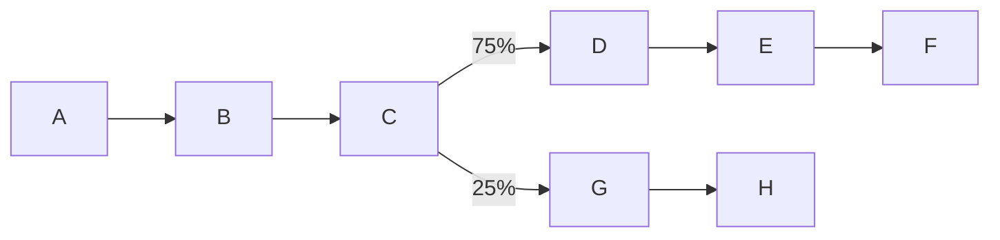

# 有向通道演化链

- 状态：失败；步骤 1 未达标，按停止条件结束后续模拟。
- 代码：`exp/2/attractor-chain`；起点 `stage/2-spiking-network`（098183e）。
- 开始日期：2026-10-09。
- 完成日期：2026-10-09；归档标签：`attempt/2/attractor-chain`。

## 目标与假设

8 个吸引子由学习形成，全部吸引子对间的有向赫布式钙规则学习经历过的先后关系。学习态保持浅、由输入驱动；演化态冻结全部学习并提高递归增益。检查短暂线索能否在适应与噪声推动下，通过加权竞争沿主链或分叉走到终点。

以下完整保留计划设计、全部验收条件与停止条件；结果按实际测量补写。共享代码 src 不改动，缓存仅写入新文件 chain-*.json。
## 实验设计

### 1.1 世界：8 个吸引子，一条主链加一个分叉



- **经历过的转移**共 7 对：A→B、B→C、C→D、C→G、D→E、E→F、G→H。它们的反向是"反向转移"，其余有序对都是"没经历过的"。
- **每个回合**从 A 开始，按上图的概率走到 F 或 H。每项 40 ms，强度 `SEQ_STIM`（背景 + 30 Hz），回合之间休息 400 ms。

### 1.2 网络（初始参数沿用平衡层 `BAL`，见 [demo/balanced-layer.mjs](../../../../demo/balanced-layer.mjs)）

- **神经元**：720 个兴奋性（8 组 × 80，加 80 个不成组；适应 b = 20 pA，τw = 300 ms），180 个快速抑制性。
- **兴奋→兴奋递归**：组内和组间的连接概率分别为 `pIn`、`pOut`，初值都是 0.1；接触点 10。可塑，参数 sMin 0.1、sMax 9、ρ0 0.1、accel 5、异突触预算 0.2，规则为 `GB_NMDA`。
- **抑制相关连接**：
  - 兴奋→抑制：概率 0.2，强度 1.5；
  - 抑制→兴奋：概率 0.4，快速 GABA_A，强度 4，抑制性可塑性（η 0.02、目标 3 Hz、上限 40）；
  - 抑制→抑制：概率 0.4，强度 4。
- **背景**：兴奋性 28 Hz、抑制性 12 Hz，每个神经元 60 条输入、每条 10 个接触点。
- **刺激强度**：变体 `STIM` = 52 Hz，序列 `SEQ_STIM` = 58 Hz。
- **规模的影响**：规模比平衡层大，入度约为 1.8 倍。吸引子阶段里抑制性可塑性会自动重标定抑制强度。如果步骤 1 的自发频率不达标，只允许在兴奋性背景 20–32 Hz、抑制性背景 8–16 Hz 内调整。

### 1.3 两种工作状态

- **学习态**：`learn: true`，递归按学到的效能，b = 20。
- **演化态**：`learn: false`（钙规则和抑制性可塑性都冻结）；把递归组的 `scale` 乘以 G，载入状态后要重新乘一次；把兴奋群参数对象的 `b` 改成目标值（同一群的神经元共用这个对象）。
- **线索**：用序列强度驱动起点组 40 ms，之后撤掉输入。
- **低噪声对照**：运行参数改为 `nIn: 600, inContacts: 1`。平均驱动不变，方差约为原来的 1/10（`SpikingNetwork.run` 已支持这两个参数）。

### 1.4 解码与指标（所有验收都以此为准）

- **分组频率**：按 10 ms 分箱，计算每组的平均频率 r_g(t)。
- **阈值**：θ = max(12 Hz, μ + 4σ)。其中 μ、σ 来自同一工作状态、同一参数下 2 s 静息里，所有组、所有分箱频率的均值和标准差。
- **当前状态**：频率最高的组，如果它不低于 θ、并且比第二名高至少 5 Hz，就是这一箱的状态；否则这一箱记为"无"。
- **停留与转移**：
  - 一次停留：同一状态的连续分箱，中间允许不超过 30 ms 的"无"；短于 20 ms 的停留丢弃。
  - 一次转移：相邻两次停留状态不同，且两者之间的"无"不超过 100 ms。超过 100 ms 的空档视为链条终止。
- **链长**：从起点 A 开始，连续经历过的正向转移的个数。第一次停留不是 A，记为 0。
- **指标**：
  - 完成率：到达 F 或 H 的试次比例；
  - 正向比例 / 反向比例：所有转移里，经历过的正向转移 / 反向转移各占多少；
  - 分叉比：C→D 次数除以 C→G 次数；
  - 停留时长的均值和变异系数（CV）；
  - 静息点燃率：3 s 静息里，有组的频率超过 10 Hz 的 20 ms 分箱占多少（学习态用 10 Hz，演化态用 θ）。

## 判据与执行顺序

### 步骤 0：建实验分支，提交初始记录

```powershell
git worktree add ..\bio-brain-wt\e2-attractor-chain -b exp/2/attractor-chain stage/2-spiking-network
New-Item -ItemType Junction -Path ..\bio-brain-wt\e2-attractor-chain\cache -Target D:\kimi_kairos\bio-brain\cache
```

在新工作区写尝试记录：状态"进行中"，抄入本计划第 1 节的设计和第 3 节的全部验收条件，单独提交一次。

验收：
- `git worktree list` 有 `e2-attractor-chain [exp/2/attractor-chain]`；
- 记录提交存在；
- `git status --short` 为空。

### 步骤 1：网络与吸引子（学习态）

学习抑制性可塑性和兴奋→兴奋递归：变体共 300 次，8 组随机抽。每次刺激原型 80 个里的随机 64 个，再加 16 个无关神经元，持续 200 ms，之后休息 300 ms。缓存为 `cache/chain-attractors.json`，约 35 分钟。

验收（测量时冻结学习）：
1. 训练前，自发的兴奋 / 抑制频率分别在 2–5 Hz 和 5–20 Hz 内；群体计数 Fano 因子（5 ms 分箱）小于 2。
2. 训练后，每一组的组内平均 ρ 不低于全体组间平均 ρ 的 2 倍。
3. 补全：只给一组的 32 个成员 150 ms。8 组平均下来，没给输入的成员比组外高至少 0.5 Hz，且至少 7 组为正。
4. 学习态稳定：静息点燃率不超过 5%。

### 步骤 2：有向联系（学习态）

在 `chain-attractors` 的基础上跑 160 个回合，每 2 个回合插 1 次变体，以维持吸引子。缓存为 `cache/chain-main.json`，约 25 分钟。

验收：
1. 7 对经历过的转移，每对的正向组平均 ρ 都比反向至少高 0.02，7 对平均至少高 0.05。
2. 分叉处 ρ(C→D) > ρ(C→G)。
3. 普遍性：56 个有序组对的平均 ρ，与回合中实际经历的一阶转移次数之间，Spearman 相关不低于 0.5；ρ 最大的 7 对里，至少 5 对是经历过的转移。
4. 吸引子保住：组内与组间之比仍不低于 2，每组不低于 1.8。
5. 学习态静息点燃率仍不超过 5%。
6. 不达标时最多补救两次：先把回合数加到 320；仍不达标，再把每项缩短到 30 ms 重训。两次都不达标就转到步骤 7，按"部分成功"收尾。

### 步骤 3：演化态标定

网格为 G ∈ {1.0, 1.2, 1.4, 1.6, 1.8, 2.0} × b ∈ {20, 40, 60, 80} pA。每个条件做 10 次试次：线索给链的终点 F（它没有学到后继），再测 3 s 静息。可以每个 G 开一个 node 进程并行跑，约 1 小时。

工作点必须同时满足：
1. **保持**：至少 80% 的试次里，F 在线索撤掉后被解码为当前状态至少 80 ms。
2. **收尾**：至少 80% 的试次里，F 的停留在 1 s 内结束。
3. **不失控**：处于激活状态的组，平均频率在 15–80 Hz 之间。
4. **静息安静**：演化态静息点燃率不超过 10%。

取满足条件的最小 G；同一 G 有多个 b 达标时取中间的 b。完整网格写进结果 JSON。

如果没有任何条件达标，启用备选方案：把 `pIn` 提高到 0.25、`pOut` 降到 0.083（入度不变），从步骤 1 起重训一次，再标定。仍没有工作点就转到步骤 7，按"部分成功"收尾。

### 步骤 4：演化链主测试（工作点上）

做 40 次试次：线索给 A 40 ms，观察 3 s，再休息 2 s。休息结束时如果还没回到静息，这次试次作废，并另补一次。

验收：
1. 完成率不低于 50%：只经过经历过的正向转移，走到 F 或 H。
2. 链长的中位数不低于 4（A→B→C→D→E 即为 4）。
3. 正向比例不低于 70%，反向比例不高于 10%。随机跳转时，命中某个特定后继的概率约为 1/7。
4. 加权竞争：C→D 和 C→G 都至少出现 3 次，分叉比在 1.5–9 之间（训练时为 3:1）。
5. 噪声推动的时序：停留时长均值在 40–400 ms 之间，CV 不低于 0.3。

### 步骤 5：对照（工作点参数不变）

1. **没学序列**（用 `chain-attractors.json`）：正向比例不高于 30%，链长中位数不超过 1。
2. **打乱顺序**：每个回合以 50% 的概率整段倒序重训，共现关系不变、顺序不一致，缓存为 `chain-shuffled.json`。验收：7 对的正向减反向 ρ 平均绝对值不超过 0.02；演化时正向比例与反向比例之差不超过 15 个百分点。
3. **无适应**（b = 0）：首个状态停留时长的中位数不少于 1 s，或者至少 50% 的试次在 1 s 内没有任何转移。
4. **低噪声**：以下两条至少满足一条，说明转移和选择是噪声推动的：
   - 分叉比不低于工作点的 2 倍；
   - 总转移次数不超过工作点的 50%。

### 步骤 6：验证脚本与回归

- 在 `verify/L4-chain.mjs` 里，把步骤 1–5 的验收逐条写成检查；在 `verify/all.mjs` 里加入 `L4g`，FAST 模式下跳过。
- 验收：
  - `node verify/L4-chain.mjs` 退出码为 0；部分成功时，它要逐条报告哪几项没通过。
  - `$env:FAST=1; npm run verify` 退出码为 0。
  - `git diff --stat stage/2-spiking-network -- src` 输出为空。

### 步骤 7：图、文档与收尾

- **图** `figures/fig13-chain.png`，四块：
  - 8×8 学到的有向效能矩阵，标出经历过的转移；
  - 20 次试次的解码状态栅格；
  - 演化中观察到的转移矩阵；
  - 分叉计数与停留时长直方图。
- **结果** `figures/chain-results.json`：全部数字，包括标定网格和各项对照。
- **文档**：
  - 尝试记录补上结果、结论和原因，单独提交；
  - 第 2 段 STATUS 更新现状和尝试列表，并把草案判据改成本计划的保持、收尾、链条判据；
  - 成功时在 README.zh-CN.md 第 4 层（脉冲版）之后新增"有向通道演化链"一节。
- **成功**（步骤 4–6 全部通过）：在 `s2-network` 工作区执行 `merge --no-ff exp/2/attractor-chain`，推送 `stage/2-spiking-network`。之后是否合并进 master、是否打 `milestone/attractor-chain`，由你决定。
- **失败或部分成功**：打附注标签 `attempt/2/attractor-chain` 并推送；把记录提交 cherry-pick 到 `stage/2-spiking-network` 后推送；删除 exp 工作区和分支。
- 验收：
  - 成功时，`git ls-remote origin stage/2-spiking-network` 与本地一致，且包含合并提交；
  - 失败时，`git ls-remote --tags origin` 含 `attempt/2/attractor-chain`；
  - 两种情况下，`git worktree list` 里都不再有 e2 工作区（成功合并后同样删除）。

## 4. 停止条件

遇到以下情况就停下并报告，不要自行改变实验设计：
- 步骤 1 不达标（吸引子都形成不了）；
- 步骤 2、3 用完补救后仍不达标；
- 任何一步需要改动 `src/` 下的共享代码。

预计总耗时约 4–6 小时，大部分是模拟。
## 结果

步骤 0 的初始记录单独提交为 `466a46d`。执行了完整的 300 次变体训练和冻结学习后的验收；学习耗时 1328.931 s（约 22.1 分钟）。其余模拟因步骤 1 未达标而没有执行。

初始背景 E=28 Hz、I=12 Hz 时，训练前 E=1.855556 Hz、I=5.002778 Hz、Fano=1.777335，E 低于 2 Hz。按计划允许的范围，仅把 E 背景调整为 30 Hz，I 背景仍为 12 Hz；变体刺激 52 Hz、序列刺激 58 Hz 保持计划列出的固定值。没有调整连接概率、学习参数或共享代码。

| 步骤 1 验收 | 实测 | 判定 |
| --- | --- | --- |
| 训练前 E 2–5 Hz、I 5–20 Hz、Fano < 2 | E 2.075000 Hz；I 5.433333 Hz；Fano 1.769625 | 通过 |
| 每组组内 / 全体组间平均 ρ ≥ 2 | 0.972947–1.830647；0/8 组达标 | 失败 |
| 8 组平均补全 ≥ +0.5 Hz，至少 7 组为正 | +0.346644 Hz；6/8 组为正 | 失败 |
| 3 s 静息点燃率 ≤ 5% | 0/150 个 20 ms 分箱，0% | 通过 |

全体组间平均 ρ 为 0.191869；组内均值与它的比值为 1.367960。各组的补全每组测 6 次：32 个成员接受 150 ms 输入，比较其余 48 个成员与组外兴奋细胞的频率。

| 组 | 训练次数 | 组内平均 ρ | 组内 / 组间比 | 未刺激成员 − 组外频率（Hz） |
| --- | --- | --- | --- | --- |
| A | 42 | 0.256589 | 1.337313 | +0.501736 |
| B | 35 | 0.254592 | 1.326906 | +0.155671 |
| C | 38 | 0.351244 | 1.830647 | +1.408565 |
| D | 34 | 0.186678 | 0.972947 | −0.350694 |
| E | 35 | 0.272277 | 1.419078 | +0.587384 |
| F | 46 | 0.319554 | 1.665478 | +0.612847 |
| G | 36 | 0.220119 | 1.147237 | −0.305556 |
| H | 34 | 0.238699 | 1.244073 | +0.163194 |

训练后静息 E=3.125926 Hz、I=8.022222 Hz、Fano=2.882626。计划只对训练前 Fano 设置门槛；训练后 Fano 是补充测量，没有新增验收条件。

步骤 2–5 均未运行，没有序列补救、G×b 标定、主链试次或对照数据。`pIn=0.25、pOut=0.083` 的备选只在步骤 3 无工作点后允许启用，本次没有进入该阶段。

### 验证与产物

- `node verify/L4-chain.mjs`：退出码 1，26 项中 3 项通过（步骤 1 的两项及 src 无改动），2 项实测失败，21 项未执行。逐项列出的未执行项不代表有相关实验结果。
- `$env:FAST=1; npm run verify`：退出码 0，L1/L2/L3/L4/L4c/L5 全部通过，107 s；L4g 在 FAST 模式下跳过。
- `git diff --stat stage/2-spiking-network -- src`：空；原有 48 个缓存文件的 SHA-256 全部一致。
- 检查点精确续算已验证：恢复后的脉冲、膜电位、兴奋/抑制权重和 ATP 账与连续运行一致；解码器的短停留、30/100 ms 间隔、非 A 起点和有向链边界检查通过。
- 已实现后续阶段入口与门槛，但由于停止条件，这些长模拟没有执行或通过科学验收。

归档标签保存 [脚本](https://github.com/vasily-tolkyov/bio-brain/blob/attempt/2/attractor-chain/demo/attractor-chain.mjs)、[逐项验证](https://github.com/vasily-tolkyov/bio-brain/blob/attempt/2/attractor-chain/verify/L4-chain.mjs)、[全部数值](https://github.com/vasily-tolkyov/bio-brain/blob/attempt/2/attractor-chain/figures/chain-results.json)、[四面板图](https://github.com/vasily-tolkyov/bio-brain/blob/attempt/2/attractor-chain/figures/fig13-chain.png) 和 [运行日志](https://github.com/vasily-tolkyov/bio-brain/tree/attempt/2/attractor-chain/experiments/logs/2026-10-09-attractor-chain)。图中橙色仅表示计划中的边，后续三个面板明确标记未运行。

忽略的缓存保存在共享目录 `D:\kimi_kairos\bio-brain\cache`：`chain-attractors.json` 与 `chain-attractor-progress.json`。工作区清理保留共享缓存。初始记录、最终记录和 STATUS 更新按失败收尾流程拣入 `stage/2-spiking-network`；实验代码留在归档标签中。

### 复现

在归档代码的工作区运行（已有匹配缓存时直接读取；无缓存时重新训练并遵守阶段门槛）：

```powershell
$env:BG = '30'
$env:BG_I = '12'
$env:MODE = 'attractors'
node demo/attractor-chain.mjs
node verify/L4-chain.mjs
$env:FAST = '1'
npm run verify
```

网络种子为 1，训练噪声种子为 1001，变体抽样种子为 3；补全噪声/抽样种子为 2001/2002，训练后静息噪声种子为 3001。结果 JSON 保存原始组矩阵、全部 48 个补全样本和背景标定候选。

## 结论与原因

本次没有形成满足计划门槛的八个吸引子，因此无法继续检验自主有向演化链。失败的直接证据是组内连接的选择性不足：组间效能也升高，八组比值均低于 2，D 组组内效能甚至低于全体组间均值；D、G 的补全差为负。静息点燃并不是本次失败项。

这些测量不能独立确定选择性不足的生物物理原因，也不能判断未运行的序列学习、递归放大、适应或噪声机制是否有效。没有把未测试的解释写成结论，也没有借用步骤 2、3 的补救去绕过步骤 1 的停止条件。

## 遗留问题

需解释当前参数下组间效能增长和组间补全差异；保持、收尾、加权分叉、链条与四项对照仍未得到本次实验的证据。来源：有向通道演化链计划的第 1、3、4 节；本记录保留完整设计、验收与停止条件，便于独立复现。
